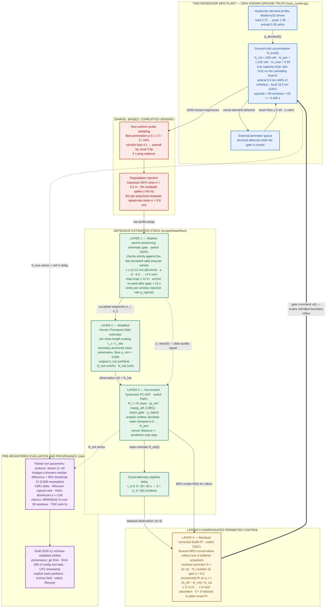
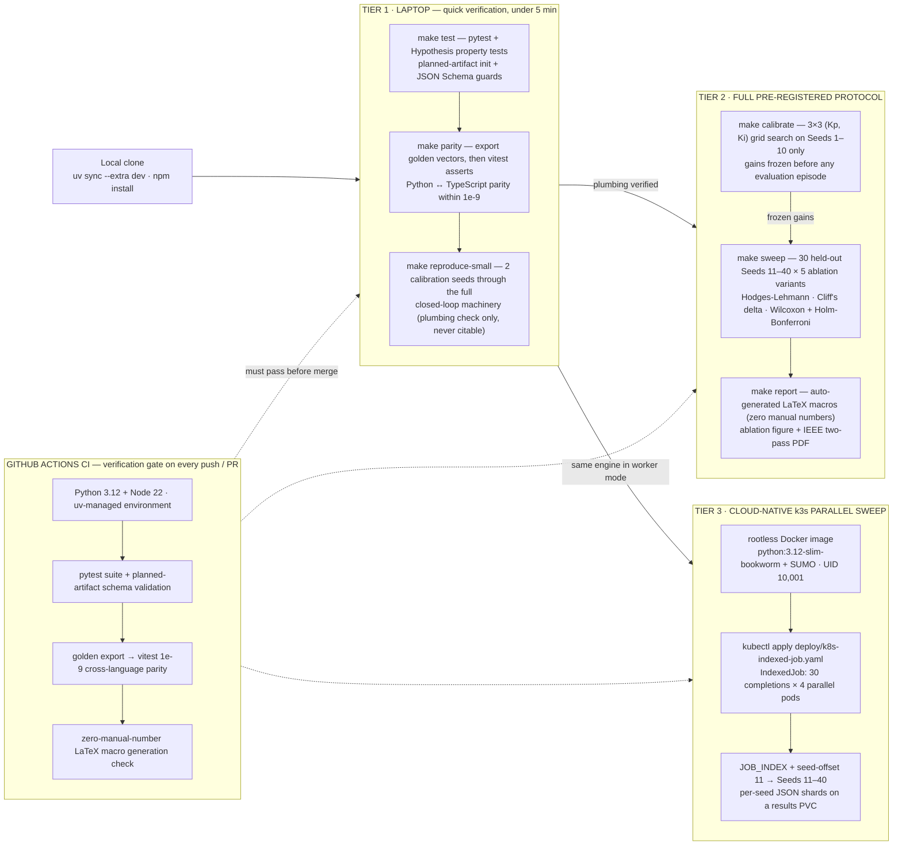

# PerimeterFlow

**Bias-Aware MFD-Based Macroscopic Traffic State Estimation and Latency-Compensated Perimeter Control under Non-Uniform Sparse Probes**

[](https://github.com/seyed-milad-jalilian/perimeterflow/actions/workflows/ci.yaml)
[](CITATION.cff)
[](pyproject.toml)
[](web_worker/parity.test.ts)
[](docs/ANALYSIS_PLAN.md)

A cloud-native, pre-registered research and simulation engine for MFD-based macroscopic traffic state estimation and perimeter gating under realistic sensing degradation — fully deterministic, provenance-tracked, and numerically identical across Python and TypeScript.

## Overview

Feedback perimeter control on the Macroscopic Fundamental Diagram (MFD) is a scalable strategy for congestion mitigation, but empirical deployment inherits four compounding failure modes: **sparse probe penetration** ($1\% \le p \le 10\%$), **topological corridor selection bias** (arterials over-sampled $4{:}1$ versus local streets), **GPS multipath outliers and burst dropouts**, and **cloud telemetry pipeline latency** ($\tau_d \in \{0\text{s}, 30\text{s}, 60\text{s}\}$).

PerimeterFlow is an open-source engine that chains four defensive layers into one closed-loop pipeline: a **stateful anchor-preserving kinematic quality gate**, a **stratified link-class Horvitz-Thompson Edie estimator**, a **two-branch hysteresis physics-constrained adaptive Kalman filter (PC-AKF)**, and a **residual-corrected Smith-PI perimeter controller** that compensates pipeline delay and provably reduces to a normalized PI controller at $\tau_d = 0$.

Scientific integrity is infrastructure here, not a promise: hypotheses, factors, and the statistical protocol are pre-registered before execution; calibration and evaluation seeds are strictly firewalled; every result artifact is a JSON document with machine-checked provenance and a status lifecycle; and the same deterministic core runs in Python and — verified to $10^{-9}$ — in a browser Web Worker written in TypeScript.

> **Pre-registration status.** The pre-registered evaluation sweep (Seeds 11–40) has **not** been executed yet. Every shipped artifact carries `"status": "planned"` with strictly `null` metrics, the LaTeX report renders `[PENDING SWEEP]` placeholders, and this README deliberately reports **no empirical numbers**. Smoke-test output (`make reproduce-small`) verifies plumbing only and must never appear in any table, figure, or claim.

## Contents

1. [Research question and hypotheses](#1-research-question-and-hypotheses)
2. [System architecture](#2-system-architecture)
3. [The four defensive layers](#3-the-four-defensive-layers)
4. [Closed-loop episode and injected degradation](#4-closed-loop-episode-and-injected-degradation)
5. [Pre-registered experimental design](#5-pre-registered-experimental-design)
6. [Determinism and cross-language parity](#6-determinism-and-cross-language-parity)
7. [Quick start and three-tier reproducibility](#7-quick-start-and-three-tier-reproducibility)
8. [Repository layout](#8-repository-layout)
9. [Cloud-native deployment (Tier 3)](#9-cloud-native-deployment-tier-3)
10. [Empirical validation: Amsterdam urban trajectories](#10-empirical-validation-amsterdam-urban-trajectories)
11. [Verification guards and CI](#11-verification-guards-and-ci)
12. [Honesty contract: artifacts and status lifecycle](#12-honesty-contract-artifacts-and-status-lifecycle)
13. [Interactive web preview](#13-interactive-web-preview)
14. [Threats to validity](#14-threats-to-validity)
15. [Citation](#15-citation)
16. [License and data governance](#16-license-and-data-governance)

## 1. Research question and hypotheses

> To what extent do sparse probe penetration ($1\% \le p \le 10\%$), topological corridor selection bias ($4{:}1$), GPS multipath outliers, burst dropouts, and telemetry pipeline latency ($\tau_d \in \{0\text{s}, 30\text{s}, 60\text{s}\}$) degrade MFD accumulation estimation and feedback perimeter gating, and what is the isolated contribution of each defensive layer?

| ID | Pre-registered hypothesis |
| --- | --- |
| **H1** — Spatial bias recovery | Under corridor-biased sampling (arterials at $4\times$ the local penetration, fleet-wide $p \le 5\%$), unstratified Edie estimation exhibits systematic positive accumulation bias; stratified link-class Horvitz-Thompson weighting anchored by boundary detector counts significantly reduces $\mathrm{NRMSE}(N)$. |
| **H2** — Stateful kinematic gating | Under combined Gaussian GPS noise and $3\%$ multipath spikes, a stateful sequential gate — evaluating kinematics strictly against each vehicle's *last accepted valid ping* — achieves lower $\mathrm{NRMSE}(N)$ and lower false-rejection rates than stateless pairwise differencing or unfiltered estimation. |
| **H3** — Hysteresis and misspecification robustness | A two-branch hysteresis PC-AKF that inflates observation covariance $R_t$ via the gate rejection rate $\rho_{\text{reject}}(t)$ maintains lower $\mathrm{NRMSE}(N)$ than static-gain Kalman filtering and naive scaling, even when reference MFD parameters $(N_{\text{crit}}, M_{\max})$ are misspecified by $\pm 20\%$ and class penetration estimates err by $\pm 30\%$. |
| **H4** — Latency-compensated perimeter control | Under pipeline delays $\tau_d \in \{30\text{s}, 60\text{s}\}$, the residual-corrected Smith-PI achieves lower Total Network Delay (TND, veh·h) than a baseline normalized PI whose gains $(K_p, K_i)$ are tuned for the exact same delay regime. |

The full statistical analysis plan is frozen in [`docs/ANALYSIS_PLAN.md`](docs/ANALYSIS_PLAN.md); design rationale for every mathematical choice is recorded in [`docs/DECISIONS.md`](docs/DECISIONS.md) (D1–D9).

## 2. System architecture



**Closed loop, one window at a time.** Each 60 s window: the plant advances the two-reservoir mass balance; probe pings are sampled, corrupted, and gated; the stratified estimator produces an accumulation observation; the PC-AKF fuses it with the physics prediction; the estimate crosses the telemetry delay buffer; the Smith-PI converts the (delay-compensated) state into a dimensionless gate command $u(t)$ that scales admitted boundary inflow for the next window. The gate's rejection rate closes a second, slower loop: it inflates the filter's observation covariance, so degrading data quality automatically makes the estimator more conservative.

**Ablation switches.** Every variant in the pre-registered matrix is a combination of three binary switches:

| Switch | Stage | Off (0) | On (1) |
| --- | --- | --- | --- |
| **G** | Layer 1 | accept-all bypass (all gate thresholds effectively infinite, rejection rate forced to 0) | stateful anchor-preserving kinematic gate |
| **F** | Layers 2–3 | uniform single-penetration Edie, no Kalman filtering (raw estimate used directly) | stratified HT-Edie + hysteresis PC-AKF |
| **C** | Layer 4 | baseline normalized PI with identical tuned gains but no delay compensation | residual-corrected Smith-PI with forward rollout |

The telemetry delay buffer sits in front of *every* controller variant — only **C1** compensates it.

## 3. The four defensive layers

### 3.1 Layer 1 — Stateful anchor-preserving kinematic quality gate

Raw pings $(t_k, x_k, y_k, v_k)$ are filtered **sequentially against each vehicle's last accepted valid anchor** $(\tilde t, \tilde x, \tilde y, \tilde v)$ — never against the previously *received* ping:

$$v_{\text{calc}} = \frac{\sqrt{(x_k - \tilde x)^2 + (y_k - \tilde y)^2}}{t_k - \tilde t}, \qquad a_{\text{calc}} = \frac{v_{\text{calc}} - \tilde v}{t_k - \tilde t}$$

A ping is accepted iff $0 \le v_{\text{calc}} \le 22.22\ \text{m/s}$ (80 km/h urban ceiling) and $-6.5 \le a_{\text{calc}} \le +4.5\ \text{m/s}^2$; backward time steps are rejected. Decision precedence is strict and ordered:

1. **Spatial validity** — NaN coordinates or map-snap distance $> 12$ m are rejected first, so a positional outlier can never enter kinematic testing.
2. **Anchor (re)initialization** — a first ping or a time gap $> 15$ s seeds a new anchor (valid range check on observed speed only) and contributes a zero-duration, zero-distance segment.
3. **Kinematic validity** — computed speed and acceleration against the anchor must be urban-plausible.

The defining property: a **rejected ping never touches the anchor**, so an isolated GPS multipath spike cannot invalidate the next genuine observation — the exact failure mode of stateless pairwise gating. The gate emits per-window statistics, and its rejection rate $\rho_{\text{reject}}(t)$ is reused downstream as a data-quality signal. Reference: `src/perimeterflow/quality_gate.py`; anchor preservation and non-negativity are asserted in `tests/test_stateful_gate.py` (unit + Hypothesis property test).

### 3.2 Layer 2 — Stratified link-class Horvitz-Thompson Edie estimator

Segments are stratified into link classes $c \in \{\text{arterial}, \text{local}\}$ with lane-kilometers $L_c$ and boundary-detector-anchored penetration estimates $\hat p_c$ (floored at $p_{\min} = 0.005$ to prevent division blow-ups). With gated time/distance accumulations $\bar\tau_c, \bar d_c$ per class over a $\Delta t_h$-hour window:

$$\hat N(t) = \frac{1}{\Delta t_h} \sum_c \frac{L_c}{L_c^{\text{obs}}} \cdot \frac{\bar\tau_c / 3600}{\max(\hat p_c,\ p_{\min})}, \qquad \hat k = \frac{\hat N}{\sum_c L_c}, \qquad \hat Q = \frac{1}{\Delta t_h \sum_c L_c} \sum_c \frac{L_c}{L_c^{\text{obs}}} \cdot \frac{\bar d_c / 1000}{\max(\hat p_c,\ p_{\min})}$$

Under corridor bias, a single fleet-wide penetration inherits the arterial over-weighting and biases accumulation upward; per-class inverse-penetration weighting removes the differential exposure (H1). Edie's generalized definitions keep time-based and distance-based quantities integrated consistently over the window. Reference: `src/perimeterflow/estimators.py` (`compute_stratified_edie`); an exact-reconstruction test recovers $N = 300$ vehicles to $10^{-9}$ under $4{:}1$ biased sampling.

### 3.3 Layer 3 — Two-branch hysteresis physics-constrained adaptive Kalman filter

Accumulation is propagated by mass balance, clamped to the physical range, with an analytically linearized outflow Jacobian:

$$N_{t|t-1} = \mathrm{clip}\big(N_{t-1} + \Delta t\,(q_t u_t - \Phi(N_{t-1})),\ 0,\ N_{\text{jam}}\big), \qquad P_{t|t-1} = F_t^2 P_{t-1} + Q,\quad F_t = 1 - \Delta t\, \Phi'(N_{t-1})$$

**Two-branch hysteresis.** Congested recovery differs from loading: the unloading branch engages when the estimate is declining while still congested ($N_{t-1} < N_{t-2}$ and $N_{t-1} > 0.8\,N_{\text{crit}}$), and is then evaluated with the reduced peak $M^{\text{unload}}_{\max} = 0.82\,M^{\text{load}}_{\max}$ while $N > 0.7\,N_{\text{crit}}$. The outflow shape is a parabolic rise to critical accumulation and a quadratic decay beyond it.

**Gate-scaled observation covariance.** The filter is provably more skeptical exactly when evidence is weakest:

$$R_t = R_{\text{base}} \left(\frac{p_{\text{ref}}}{\max(p_{\text{eff}},\ 0.005)}\right) \exp\!\big(\alpha_{\text{gate}}\, \rho_{\text{reject}}(t)\big)$$

with defaults $R_{\text{base}} = 120$, $p_{\text{ref}} = 0.05$, $\alpha_{\text{gate}} = 2.5$, $Q = 20$: inflation by penetration deficit *and* by gate rejection rate, smoothly and bounded in practice.

**Blackout rule.** When the observation is missing/NaN, $p_{\text{eff}} \le 0.001$, or $\rho_{\text{reject}} \ge 0.95$, the update is skipped entirely — a pure prediction step that keeps covariance propagation meaningful instead of pretending missing data carried information. By design, the plant itself uses slightly different constants (unloading threshold $0.75\,N_{\text{crit}}$, drop ratio $0.81$), so the filter is mildly misspecified even at a zero misspecification factor. Reference: `src/perimeterflow/estimators.py` (`HysteresisAwarePCAKF`); positive-definite covariance through 20 consecutive blackout steps is asserted in tests.

### 3.4 Layer 4 — Residual-corrected Smith-PI perimeter controller

The controller maintains ring buffers of past boundary inflows, gate commands, and its own pure open-loop model predictions. At each step it (a) rolls the **delayed** observation $z(t-d)$ forward through the MFD model across the $d$ buffered actuations, (b) blends in a residual correction against the model's stale delayed prediction:

$$\delta_{t-d} = z(t-d) - N_{\text{model}}(t-d), \qquad N_{\text{eff}}(t) = \mathrm{clip}\big(N_{\text{roll}}(t) + \gamma\,\delta_{t-d},\ 0,\ N_{\text{jam}}\big), \qquad \gamma = 0.5$$

and (c) applies an incremental PI law on the dimensionless normalized error:

$$e_t = \frac{N_{\text{eff}}(t) - N_{\text{crit}}}{N_{\text{crit}}}, \qquad u_t = \mathrm{clip}\big(u_{t-1} - K_p (e_t - e_{t-1}) - K_i\, e_t,\ 0.15,\ 1.0\big)$$

The normalized error makes the tuned gains meaningful across network sizes and demand regimes; the incremental, saturation-clipped form provides anti-windup by construction. **Exact degeneracy requirement:** at $d = 0$ the rollout and residual machinery must reduce to the plain normalized PI controller — asserted numerically in the test suite ($u = 0.893$ to a $10^{-9}$ tolerance), so the Smith structure is a provable strict generalization, not a separate heuristic. Reference: `src/perimeterflow/controllers.py`.

## 4. Closed-loop episode and injected degradation

Each episode is a fully deterministic two-reservoir simulation with 100%-known ground truth, driven exclusively by a seeded [Mulberry32](#6-determinism-and-cross-language-parity) stream — every impairment below is synthetic, reproducible, and measurable against truth.

| Episode property | Value |
| --- | --- |
| Geometry | 5,400 s episode = 90 windows × 60 s (matching the pre-registered NRMSE definition) |
| Demand profile | load 0.72 veh/s (0–1,200 s) → peak 1.28 veh/s (1,200–3,200 s) → unload 0.38 veh/s (3,200–5,400 s), plus Gaussian noise, floored at 0.1 veh/s |
| True reservoir | $N_{\text{crit}} = 420$ veh, $N_{\text{jam}} = 1{,}150$ veh, $M_{\max} = 0.95$, unloading capacity drop 0.81, process noise $\sigma = 3.5$ veh |
| Network | arterial 9.6 km carrying 46% of vehicles, local 19.2 km carrying 54%; free-flow speeds 13.5 / 8.5 m/s with linear congestion degradation |
| Perimeter actuation | gate $u(t)$ scales admitted boundary inflow; deferred demand queues externally and returns at $\le 0.45\,u$ veh/s |

| Injected impairment | Model |
| --- | --- |
| Probe penetration | $p \in \{1\%, 2\%, 5\%, 10\%\}$ fleet-wide |
| Spatial selection bias | `uniform` ($1{:}1$) or `corridor_biased`: arterial $2p$, local $0.5p$ → $4{:}1$ |
| GPS noise | zero-mean Gaussian, $\sigma = 2.5$ m |
| Multipath outliers | 3% of pings shifted by +55 m |
| Burst dropouts | 8% of 5 s sub-pings suppressed (Markovian burst behavior) |
| Speed-observation noise | $\sigma = 0.8$ m/s |
| Map-snap error | folded Gaussian, $\sigma = 3$ m |
| Pipeline latency | $\tau_d \in \{0, 30, 60\}$ s, quantized to whole control windows: $d = \lfloor \tau_d / 60 \rfloor$ (sub-window delays round down in the current runner) |

Network generation for SUMO (`src/perimeterflow/network_gen.py`) deterministically builds the 8×8 two-reservoir grid with arterial/local edge classification, a 5,400 s hysteresis trip demand, and a self-contained `simulation.sumocfg`, degrading gracefully when SUMO binaries are absent. SUMO itself is external and optional (EPL-2.0; see [`DATA.md`](DATA.md)).

## 5. Pre-registered experimental design

| Factor | Pre-registered levels |
| --- | --- |
| Fleet penetration $p$ | 0.01 · 0.02 · 0.05 · 0.10 |
| Spatial bias regime | `uniform` ($1{:}1$) · `corridor_biased` ($4{:}1$) |
| Pipeline delay $\tau_d$ | 0 s · 30 s · 60 s |
| Ablation variant | `G0_F0_C0` · `G1_F0_C0` · `G0_F1_C0` · `G1_F1_C0` · `G1_F1_C1` |
| MFD misspecification $\delta_{\text{MFD}}$ | −20% · 0% · +20% (applied to $N_{\text{crit}}$ and $M_{\max}$) |
| Penetration-estimation error $\delta_{\hat p}$ | −30% · 0% · +30% |

| Variant | Gate | Estimation | Controller |
| --- | --- | --- | --- |
| `G0_F0_C0` | off | unfiltered uniform Edie | baseline tuned PI |
| `G1_F0_C0` | on | unfiltered uniform Edie | baseline tuned PI |
| `G0_F1_C0` | off | stratified HT-Edie + PC-AKF | baseline tuned PI |
| `G1_F1_C0` | on | stratified HT-Edie + PC-AKF | baseline tuned PI |
| `G1_F1_C1` | on | stratified HT-Edie + PC-AKF | residual-corrected Smith-PI |

**Metrics.** Estimation: $\mathrm{NRMSE}(N)$ over the $T = 90$ one-minute windows, normalized by the observed true-accumulation range:

$$\mathrm{NRMSE}(N) = \frac{\sqrt{\tfrac{1}{T}\sum_{t=1}^{T}\big(\hat N_t - N^{\text{true}}_t\big)^2}}{\max_t N^{\text{true}}_t - \min_t N^{\text{true}}_t} \times 100\%$$

Control: Total Network Delay (TND, veh·h) accumulated over the episode — in-network congestion delay (accumulation × window × free-flow deficit, $v_{\text{free}} = 11.5$ m/s) plus external queue holding delay.

**Inference.** Paired, non-parametric, distribution-free: Hodges-Lehmann median difference $\hat\Delta_{\text{HL}}$ with 95% bootstrap CI (2,000 seeded resamples), Cliff's delta effect size, two-sided Wilcoxon signed-rank, and Holm-Bonferroni step-down correction at $\alpha = 0.05$ across the pre-registered family.

**Seed firewall.** Seeds 1–10 are used exclusively for calibration (reference MFD curves, filter hyperparameter $\alpha_{\text{gate}}$, and $(K_p, K_i)$ tuning for both controllers); Seeds 11–40 ($n = 30$) are frozen before the first evaluation episode and used exclusively for final statistics. Both partitions are recorded in every artifact's provenance block, so any violation is machine-visible.

**Reporting rule.** All negative, null, or statistically non-significant comparisons are reported with identical prominence to positive findings.

## 6. Determinism and cross-language parity

All stochasticity flows from a **32-bit Mulberry32** generator implemented identically in Python (`src/perimeterflow/prng.py`) and TypeScript (`web_worker/mfd_worker.ts`). Mulberry32's state update is pure 32-bit integer arithmetic — JavaScript's `Math.imul` and unsigned shifts map it exactly, and Python replicates it with 32-bit masking, so no floating-point state ever crosses the language boundary. Box-Muller Gaussian draws consume uniforms in a fixed order, with $u_1$ clamped away from zero (rationale: decision record D1 in [`docs/DECISIONS.md`](docs/DECISIONS.md)).

Parity is enforced, not assumed: Python exports golden vectors, and the vitest suite (`web_worker/parity.test.ts`) asserts the TypeScript port matches to a **tolerance of $10^{-9}$** on:

- Mulberry32 uniform and Gaussian streams (16 draws each, fixed seed),
- quality-gate accepted segments and rejection rate on a fixed ping stream,
- stratified Edie outputs $(\hat k, \hat Q, \hat N)$,
- two consecutive PC-AKF filter steps, and
- three consecutive Smith-PI gate commands (including a delayed rollout).

The check runs in CI on every push and pull request. The same TypeScript port powers the in-browser interactive lab (see [§13](#13-interactive-web-preview)), so what a visitor's browser computes is numerically identical to the Python reference.

## 7. Quick start and three-tier reproducibility

**Prerequisites:** Python ≥ 3.11 (3.12 in CI and Docker) with [`uv`](https://docs.astral.sh/uv/); Node.js ≥ 22 with npm (for the parity suite); optional: SUMO (network artifacts), LaTeX (report PDF), `kubectl` (Tier 3).

```bash
git clone https://github.com/seyed-milad-jalilian/perimeterflow.git
cd perimeterflow
uv sync --extra dev     # Python environment from the lockfile
npm install             # TypeScript toolchain (vitest) for the parity suite
```



| Make target | What it does |
| --- | --- |
| `make test` | writes the planned skeleton artifact + renders LaTeX macros, then runs the pytest suite |
| `make parity` | re-exports golden vectors from Python, then runs the vitest parity suite |
| `make reproduce-small` | runs the smoke config: 2 calibration seeds × 5 variants through the full closed-loop machinery |
| `make calibrate` | 3×3 $(K_p, K_i)$ grid search minimizing median TND on Seeds 1–10, for both controllers |
| `make sweep` | runs the 5 ablation variants over the 30 held-out seeds; emits the schema-validated ensemble artifact + report macros/figures |
| `make report` | regenerates macros + figures, then compiles the IEEE PDF (two LaTeX passes) |
| `make init-planned` | writes the null-metrics planned artifact and `report/generated_metrics.tex` |
| `make clean` | removes build and LaTeX artifacts |

Raw CLI equivalents (no Make required):

| Command | Purpose |
| --- | --- |
| `uv run python -m perimeterflow.cli --export-golden <path>` | export deterministic golden parity vectors |
| `uv run python -m perimeterflow.cli --config <cfg.yaml> --output <out.json>` | sweep a config's seeds over the ablation variants (default mode) |
| `uv run python -m perimeterflow.cli --mode calibrate --config <cfg.yaml> --output <out.json>` | grid-search controller gains on the calibration partition |
| `uv run python -m perimeterflow.cli --mode worker --seed-offset 11 --worker-out-dir /out` | run one seed slice inside an IndexedJob pod (`JOB_INDEX`-driven) |
| `uv run python -m perimeterflow.parity --path <file>` | export the extended parity-vector suite |

Library usage mirrors the pipeline:

```python
from perimeterflow import (
    GateConfig, HysteresisAwarePCAKF, Mulberry32, NetworkClassSpec, ProbePing,
    ResidualCorrectedSmithPIController, compute_stratified_edie,
    run_stateful_quality_gate,
)

rng = Mulberry32(42)                                    # deterministic across Python and TypeScript

pings = [
    ProbePing("v1", "arterial",  0.0,   0.0, 0.0, 10.0, 1.0),
    ProbePing("v1", "arterial",  5.0,  50.0, 0.0, 10.0, 1.0),
    ProbePing("v1", "arterial", 10.0, 200.0, 0.0, 30.0, 1.0),   # multipath spike
    ProbePing("v1", "arterial", 15.0, 150.0, 0.0, 10.0, 1.0),   # true ping survives the spike
]
gate = run_stateful_quality_gate(pings, GateConfig())            # anchor-preserving filter

specs = {
    "arterial": NetworkClassSpec(length_km=10.0, estimated_penetration=0.04),
    "local":    NetworkClassSpec(length_km=20.0, estimated_penetration=0.01),
}
k_hat, q_hat, n_hat = compute_stratified_edie(gate.segments, specs)   # veh/km · veh/h · veh

kf = HysteresisAwarePCAKF(n_init=200.0, n_crit=400.0, n_jam=1000.0, m_max_load=0.9)
n_est = kf.step(0.8, 1.0, n_hat, p_eff=0.02, rejection_rate=gate.rejection_rate)

controller = ResidualCorrectedSmithPIController(n_crit=400.0, delay_steps=1)
u = controller.compute_u(n_est, 0.8, kf)                # perimeter gate command, u ∈ [0.15, 1.0]
```

## 8. Repository layout

```
.
├── configs/                  # pre-registered YAML protocols (smoke · calibration · evaluation)
├── data/
│   ├── golden/               # committed Python → TypeScript golden parity vectors
│   └── schemas/              # Draft 2020-12 MFD experiment artifact schema
├── deploy/
│   ├── Dockerfile            # rootless python:3.12-slim + SUMO image (UID 10,001)
│   └── k8s-indexed-job.yaml # IndexedJob: 30 completions × 4 parallel workers
├── docs/
│   ├── ANALYSIS_PLAN.md      # pre-registered hypotheses, factors, statistics
│   ├── DECISIONS.md          # design and mathematical decision records (D1–D9)
│   └── THREATS_TO_VALIDITY.md
├── report/                   # IEEE LaTeX report + auto-generated macros and figures
├── results/                  # schema-validated experiment artifacts (runtime-generated)
├── site_preview/             # interactive Web-Worker lab + printable dossier (staging)
├── src/perimeterflow/        # the Python engine
│   ├── prng.py               #   Mulberry32 — deterministic 32-bit PRNG (Python reference)
│   ├── quality_gate.py       #   Layer 1: stateful anchor-preserving kinematic gate
│   ├── estimators.py         #   Layer 2: stratified HT-Edie · Layer 3: hysteresis PC-AKF
│   ├── controllers.py        #   Layer 4: residual-corrected Smith-PI perimeter controller
│   ├── traci_runner.py       #   closed-loop two-reservoir episode engine + corruption injection
│   ├── network_gen.py        #   SUMO 8×8 two-reservoir grid, demand, and sumocfg generator
│   ├── amsterdam_validator.py#   offline empirical estimation validation (NDW / Gemeente Amsterdam)
│   ├── stats_eval.py         #   non-parametric statistics + artifact schema validation
│   ├── parity.py             #   extended golden parity-vector exporter
│   └── cli.py                #   calibrate / sweep / worker / golden-export entry points
├── tests/                    # pytest + Hypothesis verification suite
├── web_worker/               # strict TypeScript port + vitest golden parity suite
├── DATA.md                   # external data licenses and citations
├── Makefile                  # three-tier reproducibility protocol
├── CITATION.cff              # citation metadata
└── pyproject.toml            # packaging and tool configuration (uv-managed)
```

The three shipped configs share one field vocabulary (`seeds`, `penetration_rate`, `bias_mode`, `delay_s`, `episode_length_s`, `dt_window_s`, misspecification factors): the smoke test is a genuine dry run of the same machinery, never a parallel toy path — and it is labeled, in-file, as never citable.

## 9. Cloud-native deployment (Tier 3)

**Container image** (`deploy/Dockerfile`): `python:3.12-slim-bookworm` with `sumo` and `sumo-tools` preinstalled (`SUMO_HOME` set), a dedicated non-root user (UID/GID 10,001), `pip install .` of the engine, and the CLI as entrypoint (`python -m perimeterflow.cli`).

**Kubernetes IndexedJob** (`deploy/k8s-indexed-job.yaml`):

- `completions: 30`, `parallelism: 4`, `completionMode: Indexed` — 30 seed slices across 4 concurrent pods;
- each pod derives its seed from the job-completion index (`JOB_INDEX` + `--seed-offset=11` → Seeds 11–40) and runs all 5 ablation variants for that seed, writing a `seed_NNN.json` shard to a results PVC;
- hardened by default: `runAsNonRoot` (UID 10,001), read-only root filesystem, all Linux capabilities dropped, no privilege escalation, `emptyDir` scratch capped at 1 Gi;
- resources: requests 400m CPU / 1 Gi memory, limits 500m / 2 Gi per pod.

Prerequisites: the `perimeterflow` namespace and the `perimeterflow-results-pvc` claim must exist, and the image (`ghcr.io/seyed-milad-jalilian/perimeterflow:latest`) must be published. Then:

```bash
kubectl apply -f deploy/k8s-indexed-job.yaml
```

## 10. Empirical validation: Amsterdam urban trajectories

`src/perimeterflow/amsterdam_validator.py` evaluates the estimation stack on an empirical Amsterdam urban corridor slice (NDW / Gemeente Amsterdam open data), comparing unstratified versus stratified + PC-AKF accumulation NRMSE window-by-window:

```python
from pathlib import Path
from perimeterflow import evaluate_amsterdam_trajectory_slice

result = evaluate_amsterdam_trajectory_slice(Path("data/amsterdam_subset/slice.csv"), penetration_rate=0.03)
# AmsterdamValidationResult(
#   slice_id, penetration_rate,
#   nrmse_unstratified_pct, nrmse_stratified_pcakf_pct,
#   closed_loop_actuation_supported=False)   # enforced
```

**Honest scope.** The benchmark validates *estimation accuracy only*. Closed-loop perimeter gating cannot be counterfactually actuated on historical offline logs, so the control hypothesis (H4) is exclusively simulation-supported — the validator hard-codes `closed_loop_actuation_supported=False` to keep that boundary machine-checkable. Expected CSV columns: `timestamp_s, site_id, link_class, x_m, y_m, speed_kmh, true_accumulation_veh` (optional `is_sampled_probe`).

**No bundled datasets.** `data/amsterdam_subset/` is an intentionally empty placeholder: users who lawfully obtain the Amsterdam export place a license-compliant subset there. Redistribution terms, attribution requirements (NDW and Gemeente Amsterdam), and citations are governed by [`DATA.md`](DATA.md); any quantitative claim on this benchmark must be reproduced locally by the reader.

## 11. Verification guards and CI

| Guard (pytest) | Asserts |
| --- | --- |
| `test_stateful_gate.py` | an isolated multipath spike is rejected *and* the next genuine ping is preserved against the intact anchor; Hypothesis property — all emitted segments are non-negative |
| `test_estimators_controllers.py` | stratified Edie reconstructs $N = 300$ veh exactly under $4{:}1$ biased sampling; PC-AKF covariance stays positive-definite through 20 prediction-only blackout steps; Smith-PI equals plain PI at zero delay ($u = 0.893$, tolerance $10^{-9}$) |
| `test_schema_and_provenance.py` | the planned skeleton (all metrics `null`) validates against the schema; a corrupted `config_sha256` provenance hash is rejected |
| `test_amsterdam_validator.py` | the validator runs on a synthetic slice, returns finite non-negative NRMSEs, and raises on missing files |
| `web_worker/parity.test.ts` (vitest) | the TypeScript port matches Python golden vectors within $10^{-9}$ across PRNG streams, gate, Edie, PC-AKF, and Smith-PI |

**CI** (`.github/workflows/ci.yaml`, Ubuntu, Python 3.12, Node 22, uv-managed environment) runs on every push/PR: planned-artifact initialization + JSON-Schema validation via pytest, the $10^{-9}$ cross-language golden parity check via vitest, and a zero-manual-number check on the auto-generated LaTeX macros.

## 12. Honesty contract: artifacts and status lifecycle

Every result artifact is a JSON document validated by a Draft 2020-12 schema (`data/schemas/mfd_artifact.schema.json`) that requires a full provenance block — artifact and run identifiers, git SHA, SHA-256 content hashes of the exact configuration and input data, UTC generation timestamp, mode, license, and **both seed partitions** — and types every numeric result field as *number-or-null*, so a pre-run artifact is fully valid while containing zero numbers.

```mermaid
stateDiagram-v2
    direction LR
    state "planned" as planned
    state "running" as running
    state "results-unreviewed" as resultsUnreviewed
    state "reproduced-in-ci" as reproducedInCi
    [*] --> planned: artifact written — all metrics null
    planned --> running: closed-loop episodes executing
    running --> resultsUnreviewed: sweep complete — metrics populated
    resultsUnreviewed --> reproducedInCi: independent CI reproduction
    reproducedInCi --> [*]: citable
```



The report pipeline contains **zero manual numbers**: `report/render_tex_macros.py` auto-generates `generated_metrics.tex` from the artifact, rendering `[PENDING SWEEP]` placeholders while metrics are null, and `report/generate_figures.py` renders a "pending" figure rather than an empty chart. CI asserts the macro file is generated. Schema tests assert both that clean planned artifacts validate and that provenance-missing payloads are rejected.

## 13. Interactive web preview

`site_preview/` is a portable staging bundle for the project site: a dual-lens **interactive lab page** that runs the parity-verified TypeScript engine live in a Web Worker (mechanics demonstration on a reference sample — badged as such, never as a research result), a 4-sheet A4-landscape **print dossier** in a Swiss grid, Zero-Inline CSP headers, and a Playwright suite asserting zero CSP violations, zero axe accessibility errors, and PDF export. The page badge reads the artifact status and renders *Pending Execution (Pre-registered in ANALYSIS_PLAN.md)* while `meta.status == "planned"`. Transfer instructions and commands live in [`site_preview/README.md`](site_preview/README.md).

## 14. Threats to validity

Limitations are documented exhaustively and *before execution*, so they cannot be retro-fitted to excuse inconvenient results — see [`docs/THREATS_TO_VALIDITY.md`](docs/THREATS_TO_VALIDITY.md). Highlights: the two-reservoir "well-mixed" abstraction; a synthetic regular grid with a designed (not measured) partitioning; simulation-derived ground truth that inherits simulator bias; penetration estimates anchored to boundary loops; simplified corruption envelopes; constant, window-quantized latency; heuristic residual blending gain; residual optimism from tuning within one simulated environment; limited power at $n = 30$ paired seeds; and the irreducible offline-validation constraint on control claims. No empirical number in this repository should be read as a measurement until the artifact status advances.

## 15. Citation

If you use PerimeterFlow in your research, please cite this software. Citation metadata is recorded in [`CITATION.cff`](CITATION.cff) (also available via GitHub's *Cite this repository* dialog):

```yaml
cff-version: 1.2.0
title: "PerimeterFlow: Bias-Aware MFD-Based Macroscopic Traffic State Estimation and Latency-Compensated Perimeter Control"
message: "If you use PerimeterFlow in your research, please cite this software."
type: software
authors:
  - family-names: Jalilian
    given-names: Seyed Milad
    affiliation: "University of Naples Federico II"
repository-code: "https://github.com/seyed-milad-jalilian/perimeterflow"
license: MIT
```

By project rule, version metadata is deliberately omitted: the canonical citation identity of a checkout is its **Git commit hash**, which every artifact records in its provenance block.

## 16. License and data governance

- **Code and simulation manifests:** MIT (recorded in `pyproject.toml` and `CITATION.cff`).
- **No bundled datasets:** all external data is user-provided under its own terms — Amsterdam urban trajectories (NDW / Gemeente Amsterdam, CC BY 4.0 / Open Data; attribution required) are documented in [`DATA.md`](DATA.md).
- **SUMO:** an external simulator under EPL-2.0; installed separately, never redistributed here.
- **Golden parity vectors** (`data/golden/`): MIT, same as the code.
- **Result artifacts:** each carries its own `license` field, enforced by the JSON schema at the point of use.
