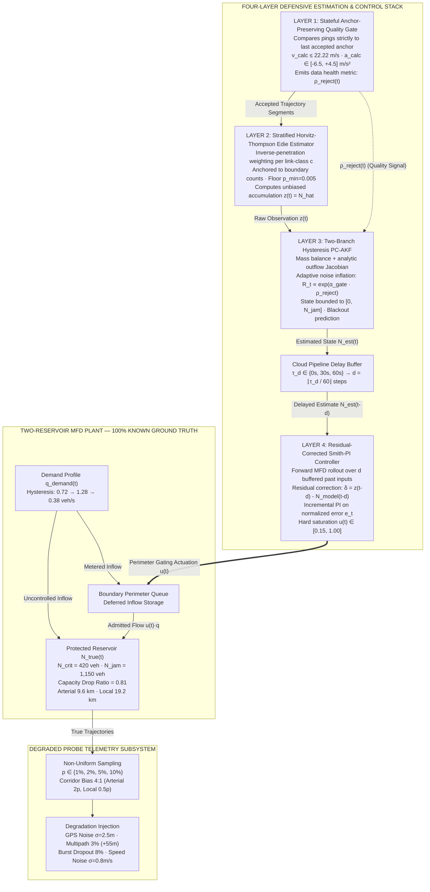

# Research Proposal

# Bias-Aware MFD-Based Macroscopic Traffic State Estimation and Latency-Compensated Perimeter Control under Non-Uniform Sparse Probes

* **Document Type:** Pre-Registered Research Proposal (Narrative & Methodological Specification)
* **Date / Current Context:** October 17, 2026
* **Principal Investigator:** Seyed Milad Jalilian
* **Affiliation:** University of Naples Federico II
* **Repository / Software Engine:** [PerimeterFlow](https://github.com/seyed-milad-jalilian/perimeterflow) (Open-source, MIT License)
* **Pre-Registration Status:** **Frozen Protocol** (`docs/ANALYSIS_PLAN.md`, SHA-256: `dd6b39b457731f5506f4e6616331687563159615e51f2d085a075666809dbd41`, commit `99acd494c34dd5006c316b5bec9f00d2b2a5de9f`)
* **Evidentiary Standing:** **Pre-Sweep / Planned.** In strict adherence to the project's honesty contract, all evaluation seed metrics (`Seeds 11..40`) remain `null`, and all emitted artifacts carry `"status": "planned"`. No empirical or counterfactual claims are stated prior to the execution of the frozen pipeline.

---

> ### Scientific Integrity and Pre-Registration Disclaimer
> This research proposal describes a fully operational, open-source computational research engine and formalizes the pre-registered scientific protocol designed to evaluate it. Hypotheses $H_1$ through $H_4$, experimental factors, ablation switches, evaluation metrics, and non-parametric statistical inference procedures are immutably pre-registered. In accordance with open-science best practices, this proposal contains **zero speculative, synthetic, or unvalidated empirical numbers**. The small smoke-test runs executed during continuous integration exist exclusively to verify software plumbing and numerical determinism, and are strictly non-citable as scientific evidence.

---

## 1. Executive Summary

Feedback perimeter control built upon the Macroscopic Fundamental Diagram (MFD) represents one of the most theoretically elegant paradigms for mitigating metropolitan-scale traffic congestion. By regulating vehicle inflows at regional boundaries, perimeter gating protects dense urban reservoirs from entering hypercongested, gridlocked regimes where throughput collapses. However, translational deployment in contemporary smart cities inherits four compounding, non-linear failure modes:
1. **Extreme probe sparsity** ($1\% \le p \le 10\%$), where commercial connected vehicle fleets sample only a minuscule fraction of circulating traffic;
2. **Topological corridor selection bias** ($4:1$ over-sampling of high-capacity arterials relative to local streets), driven by commercial fleet routing and ride-hailing demand patterns, which systematically corrupts spatial averaging;
3. **Severe GPS degradation**, including multipath position spikes ($+55\,\text{m}$) in dense urban canyons and burst dropouts ($8\%$ packet loss), which trigger catastrophic cascading errors in stateless kinematic filters; and
4. **Cloud telemetry pipeline latency** ($\tau_d \in \{0\,\text{s}, 30\,\text{s}, 60\,\text{s}\}$), arising from edge-to-cloud transmission, map-matching, and batch processing, which induces phase lag and destabilizes closed-loop feedback controllers.

Existing literature predominantly addresses these challenges in isolation—evaluating state estimation under uniform probe assumptions, or designing advanced perimeter controllers that presume instantaneous, perfect, and unbiased accumulation observations. 

This research project, titled **PerimeterFlow**, presents a unified, closed-loop defensive architecture designed to isolate and resolve all four failure modes simultaneously. The proposed methodology introduces four tightly integrated layers:
1. **Layer 1 (Stateful Anchor-Preserving Kinematic Quality Gate):** A sequential filter that evaluates incoming probe pings strictly against each vehicle's *last accepted valid anchor*, preventing multipath spikes from corrupting subsequent valid observations and emitting a real-time data rejection rate $\rho_{\text{reject}}(t)$;
2. **Layer 2 (Stratified Link-Class Horvitz-Thompson Edie Estimator):** An inverse-probability-weighted spatial estimator that partitions urban infrastructure into arterial and local strata, removes corridor sampling bias, and anchors penetration rates to boundary infrastructure counts;
3. **Layer 3 (Two-Branch Hysteresis Physics-Constrained Adaptive Kalman Filter - PC-AKF):** A macroscopic mass-balance estimator incorporating an asymmetric loading/unloading production curve that dynamically inflates its observation noise covariance $R_t$ as a function of the gate's rejection rate $\rho_{\text{reject}}(t)$, establishing an adaptive information-theoretic coupling between sensor degradation and filter skepticism; and
4. **Layer 4 (Residual-Corrected Smith-PI Perimeter Controller):** A latency-compensated feedback regulator that rolls delayed state observations forward across buffered historical actuations via the nonlinear MFD plant model and blends an empirical residual correction term, provably degenerating to a standard normalized PI controller when delay is zero.

The project is governed by an unprecedented research integrity framework. All hypotheses ($H_1$--$H_4$), experimental factors, and non-parametric statistical decision rules are cryptographically frozen prior to evaluation. Seeds $1..10$ are firewalled for calibration, while Seeds $11..40$ ($n=30$) are reserved strictly for held-out evaluation using Hodges-Lehmann median differences, Cliff's delta effect sizes, and Holm-Bonferroni-adjusted Wilcoxon signed-rank tests. Cross-language numerical determinism ($\le 10^{-9}$ tolerance) is enforced between the Python simulation core and an in-browser TypeScript Web Worker via a custom Mulberry32 pseudo-random number generator, enabling reproducible cloud execution and client-side peer review.

---

## 2. Background and State of the Art

### 2.1 The Macroscopic Fundamental Diagram: From Existence to Network Dynamics
The foundational concept of a network-level macroscopic relationship between traffic density and space-mean flow was initially conceptualized by Godfrey (1969) and later formalized by Herman and Prigogine (1979) and Daganzo (2007). The definitive empirical verification of the urban Macroscopic Fundamental Diagram (MFD) was achieved by Geroliminis and Daganzo (2008) using comprehensive loop-detector and taxi GPS data from Yokohama, Japan. They demonstrated that urban networks exhibiting reasonably homogeneous spatial distributions of congestion possess a well-defined, reproducible, and unimodal relationship linking regional accumulation $N(t)$ (vehicles) to total circulating flow $Q(t)$ or network production $P(t) = V(t) \cdot N(t)$ (veh$\cdot$km/h). Daganzo and Geroliminis (2008) provided the analytical underpinnings of this phenomenon via variational theory and method-of-cuts approximations.

Subsequent investigations, however, revealed that the assumption of a static, univalued MFD breaks down under realistic operating conditions. Buisson and Ladier (2009) documented significant scatter and multi-valuedness in empirical data from Toulouse, France, demonstrating that spatial heterogeneity in vehicle distribution degrades network outflow. Daganzo, Gayah, and Gonzales (2011) proved analytically that multi-route symmetric networks undergo dynamic bifurcations at high accumulations, rendering symmetric traffic states unstable. Gayah and Daganzo (2011) established that networks clearing from peak congestion exhibit prominent clockwise hysteresis loops—yielding substantially lower outflow during the recovery (unloading) phase than during the onset (loading) phase for identical network accumulations. Geroliminis and Sun (2011b) corroborated these hysteresis phenomena on freeway networks, identifying spatial variance in link occupancy as the primary driver of capacity collapse. Because these pathologies are rooted in spatial heterogeneity, restoring the homogeneity precondition through data-driven network partitioning has become a research thread in its own right, ranging from polycentric congestion-pattern partitioning for protected-network identification (Jiang, Keyvan-Ekbatani, and Ngoduy, 2023) to systematic cross-comparisons of machine-learning clustering algorithms for MFD-based applications (Alayasreih et al., 2025). More recently, multi-modal extensions (3D-MFD) have captured the complex interactions between private vehicles and surface public transit (Geroliminis et al., 2014; Loder et al., 2017; Johari and Keyvan-Ekbatani, 2024), while comprehensive retrospective surveys (Johari et al., 2021) emphasize that macroscopic modeling must explicitly account for network-level capacity drop and transient queue dynamics.

### 2.2 Perimeter Control and Gating: Evolution and Paradigms
The operational utility of the MFD lies in its direct mapping to feedback control. Because network production reaches an absolute maximum at a critical vehicle accumulation $N_{\text{crit}}$, any accumulation beyond $N_{\text{crit}}$ causes network outflow to deteriorate toward gridlock. Daganzo (2007) proposed regulating inflows at the perimeter of an urban zone to maintain accumulation near $N_{\text{crit}}$. Keyvan-Ekbatani et al. (2012) operationalized this concept into a practical feedback gating strategy by introducing a proportional-integral (PI) regulator that actuates boundary signal timing based on real-time accumulation measurements. Their feedback gating framework demonstrated extreme elegance: it operated robustly without requiring dynamic origin-destination (OD) matrices or detailed microscopic link models. Keyvan-Ekbatani et al. (2013) demonstrated that gating remains stable even when guided by reduced operational MFDs constructed from a sparse subset of central links, while Keyvan-Ekbatani et al. (2013, 2016) extended the paradigm to multiple boundaries and concentric urban regions.

Parallel to classical feedback control, optimal and predictive control frameworks emerged. Haddad and Geroliminis (2012) established the Lyapunov-based closed-loop stability of two-region perimeter control systems. Geroliminis, Haddad, and Ramezani (2013) developed nonlinear Model Predictive Control (MPC) formulations to optimize inter-regional boundary transfers. Ampountolas and Geroliminis (2013) synthesized boundary flow control for multi-reservoir heterogeneous networks. Ramezani, Haddad, and Geroliminis (2015) introduced hierarchical perimeter control structures explicitly modeling the dynamics of spatial heterogeneity. Haddad (2016) incorporated explicit boundary queue dynamics into optimal control synthesis, preventing perimeter queues from spilling back into upstream networks. Kouvelas, Saeedmanesh, and Geroliminis (2017) integrated data-driven adaptive optimization to tune feedback setpoints dynamically. More recently, Keyvan-Ekbatani et al. (2021) optimized the distribution of metered flow across gated boundary intersections through queue- and delay-balancing approaches, and Wang, Jiang, and Keyvan-Ekbatani (2026) examined the accuracy of discrete-time queue dynamics simulations in multi-reservoir trip-based models.

Over the past five years (2021–2026), the MFD control literature has rapidly branched into four advanced frontiers:
* **Predictive, Robust, and Constrained Control:** Kouvelas, Saeedmanesh, and Geroliminis (2023) developed linear parameter-varying (LPV) formulations for model-predictive perimeter control, reducing computational overhead while retaining structural guarantees. Sirmatel and Geroliminis (2021) formalized stabilizing economic MPC schemes under bounded disturbances, while Qian et al. (2024) synthesized $H_\infty$ robust perimeter control integrated with regional route guidance. Yuan et al. (2023) developed computational methods for multi-region feedback control under state-dependent transmission delays, while Jiang and Keyvan-Ekbatani (2023) integrated deep learning with MPC for hybrid perimeter control over real-time partitions of heterogeneous urban networks.
* **Reinforcement Learning and Model-Free Schemes:** Addressing nonlinear model mismatches, Zhou and Gayah (2021, 2023) proposed deep reinforcement learning (DRL) and multi-agent DRL architectures for multi-region perimeter metering. Chen et al. (2022) engineered data-efficient RL algorithms for adaptive optimal gating, and Chen, Geroliminis, and Zhong (2024) developed an iterative adaptive dynamic programming (IADP) actor-critic architecture that explicitly circumvents model-plant mismatch. Li et al. (2024) formulated non-cooperative perimeter control via extended mean-field multi-agent reinforcement learning. Concurrently, data-driven Model-Free Adaptive Control (MFAC) schemes utilizing dynamic linearization have been developed to bypass explicit physical modeling (Li and Hou, 2021; Hou and Lei, 2022).
* **Network Resilience, Games, and Mixed Environments:** Guo and Ban (2020) analyzed perimeter control under instantaneous dynamic user equilibrium (DUE) using differential complementarity systems. Gao et al. (2022) and Zhu et al. (2024) explored network resilience enhancement and recovery under structural disruptions, while Guo, Li, and Ban (2025) formulated hierarchical perimeter control operating in mixed connected autonomous vehicle (CAV) and human-driven vehicle environments.
* **Evaluation, Hybridization, and Deployment Evidence:** Tsitsokas, Kouvelas, and Geroliminis (2023) combined efficient Max Pressure signal control with perimeter gating for dynamically congested networks, while de Souza et al. (2024) provided systematic microsimulation evidence for selecting among feedback perimeter control, the real-time network-wide signal strategy TUC (Traffic-responsive Urban Control), and their combination on a realistic Christchurch CBD network, finding that the hybrid deployment boosts network-wide throughput.

### 2.3 The Sensing Reality: Sparse, Biased, and Corrupted Probes
Despite significant mathematical advances in controller synthesis, the empirical Achilles' heel of MFD-based control remains **state observability**. The overwhelming majority of perimeter control studies assume that the true network accumulation $N(t)$ is either directly accessible or perfectly measurable via ubiquitous loop detectors (Keyvan-Ekbatani et al., 2012; Sirmatel and Geroliminis, 2018). In modern cities, however, inductive loop infrastructure is expensive to maintain, spatially sparse, and prone to severe hardware drift (Ambühl and Menéndez, 2016). One mitigation has been the identification of minimal informative sensor subsets for so-called reduced network MFD estimation: Mousavizadeh and Keyvan-Ekbatani (2024) demonstrated that joint topological and traffic-flow feature selection sustains accurate reduced MFDs at loop-detector coverage as low as $1\%$, and, notably, that queue-related traffic features matter more during recovery while topological features matter more during loading—empirical corroboration that the loading and recovery phases are governed by distinct network mechanisms, consistent with the hysteresis evidence above.

Consequently, transportation authorities increasingly rely on Floating Car Data (FCD) collected from commercial connected vehicle fleets, transit buses, ride-hailing platforms, and mobile navigation devices (Gayah and Dixit, 2013; Nagle and Gayah, 2014; Paipuri et al., 2020). While Edie (1963) provided the generalized spatiotemporal definitions required to compute network density and flow from trajectory segments, translating probe vehicle trajectories into total network accumulation requires scaling by the fleet penetration rate $p$. 

Crucially, real-world probe data violates the idealized assumptions of classical traffic flow theory in three fundamental ways:
1. **Low and Non-Uniform Penetration:** Commercial fleet penetration is typically low ($1\% \le p \le 10\%$) and varies dynamically across time and space (Du, Rakha, and Gayah, 2016; Saffari, Yildirimoglu, and Hickman, 2022). Ambühl et al. (2017) demonstrated empirically in Zurich that probe penetration fluctuates widely and that naive scaling produces massive estimation variance. Paipuri et al. (2020) showed using mobile phone data that spatial penetration gradients severely distort empirical MFD curves. Most recently, Mousavizadeh and Keyvan-Ekbatani (2026) introduced a model-driven estimator for multi-reservoir systems that fuses sparse floating car data with loop detector measurements and recovers outflow network MFDs without requiring known penetration rates—a major advance for sparse-data monitoring that nonetheless addresses open-loop estimation rather than closed-loop, bias-corrected perimeter gating.
2. **Topological Corridor Selection Bias:** Commercial probes (e.g., taxis, delivery vans, connected fleets) do not sample the urban topology uniformly. They over-sample major arterial corridors and freeway links while drastically under-sampling local and residential access streets. Ambühl et al. (2017) identified this as a critical "link selection bias" that systematically inflates observed occupancies and distorts the density scale. Lu et al. (2026) verified on Chengdu trajectory datasets that taxi fleets exhibit up to a $4:1$ sampling disparity between central arterials and peripheral roads, leading to severe accumulation overestimation if uncorrected. Horvitz and Thompson (1952) established the foundational statistical theory for inverse-probability weighting under unequal sampling designs, yet its integration into stratified macroscopic traffic estimation remains largely unexplored.
3. **Kinematic Outliers and Sensor Degradation:** Raw probe pings collected from smartphones and commercial telematics units in urban environments are severely corrupted by GPS multipath reflections off high-rise buildings (urban canyon effects), coordinate drift, map-matching ambiguities (Newson and Krumm, 2009), and burst dropouts. Stateless filters that evaluate velocity or acceleration by differencing consecutive *received* pings fail catastrophically: an isolated $+55\,\text{m}$ multipath jump corrupts not only the current point but also the subsequent valid point, triggering cascading false rejections and obliterating true travel-time integration.

### 2.4 State Estimation for Closed-Loop MFD Regulation
Closing the loop between degraded probe observations and feedback gating requires robust state estimation. Wang and Papageorgiou (2005) established the standard Extended Kalman Filter (EKF) paradigm for macroscopic freeway state estimation. In the MFD domain, Saeedmanesh, Kouvelas, and Geroliminis (2021) developed an EKF framework for multi-region urban networks using loop-detector measurements, while Sirmatel and Geroliminis (2019) formulated nonlinear Moving Horizon Estimation (MHE) to jointly infer boundary demands and regional accumulations. Qi (2024) addressed stochasticity and partial observability by formulating perimeter control as a Partially Observable Markov Decision Process (POMDP). Trinh et al. (2024) developed stochastic switching-mode Kalman and unscented filters for urban arterial estimation that incrementally assimilate multi-source measurements, while Mousavizadeh and Keyvan-Ekbatani (2026) embedded sparse, penetration-unknown floating car data within a model-driven multi-reservoir estimator built on outflow network MFDs, arguing that outflow-based—rather than production-based—curves constitute the more robust foundation for accumulation-based modeling.

However, existing Kalman filtering architectures for MFD systems treat observation noise covariance $R_t$ as a static, pre-calibrated matrix or adjust it solely based on nominal penetration rates. They lack an architectural mechanism to dynamically ingest data-quality health signals emitted by upstream kinematic quality gates. When GPS multipath bursts or communication dropouts spike, a static-gain filter places undue trust in severely corrupted measurements, inducing high-frequency controller chattering and catastrophic false gating.

### 2.5 Actuation Latency and Dead Time in Cloud-Native ITS
Modern Intelligent Transportation Systems (ITS) are shifting toward cloud-hosted control platforms and software-as-a-service (SaaS) architectures. In such pipelines, raw probe pings are streamed via cellular networks, ingested by message brokers, map-matched against road geometries, aggregated into macroscopic windows, and processed by control algorithms before actuation commands are transmitted back to boundary signal controllers. 

This telemetry pipeline introduces unavoidable dead time ($\tau_d \in [30\,\text{s}, 60\,\text{s}]$). In feedback systems, uncompensated time delay degrades phase margin, induces limit-cycle oscillations, and can drive an otherwise stable perimeter controller into destructive instability (Keyvan-Ekbatani, Papageorgiou, and Papamichail, 2014; Yuan et al., 2023). While Keyvan-Ekbatani, Papageorgiou, and Papamichail (2014) tackled remote gating delays by retuning linear PI gains to a conservative, sluggish response, classical process control literature demonstrates that dead time is most effectively eliminated via predictor architectures (Smith, 1957; Normey-Rico and Camacho, 2008). The synthesis of a Smith-type predictor operating over the nonlinear conservation dynamics of an MFD reservoir, endowed with residual disturbance correction and provable degeneracy to standard PI control at zero delay, has not been established in the perimeter control literature.

### 2.6 The Computational Credibility Gap in Transportation Science
Finally, the computational transportation literature faces a growing reproducibility and credibility crisis. Scientific reforms across the computational sciences (Kerr, 1998; Simmons, Nelson, and Simonsohn, 2011; Sandve et al., 2013; Munafò et al., 2017; Nosek et al., 2018) have emphasized that unconstrained exploratory simulation—where random seeds are cherry-picked, hypotheses are retrofitted after examining simulation trajectories (HARKing), and negative results are silently discarded—generates overly optimistic, non-replicable claims. In microscopic and macroscopic traffic simulation, studies routinely report performance based on a single arbitrary seed ($N=1$) or unblinded hyperparameter sweeps where evaluation seeds leak into calibration. Furthermore, computational pipelines are rarely verifiable across heterogeneous compute environments, and simulation outputs are rarely paired with machine-checkable provenance schemas.

---

## 3. Research Gap Analysis

A critical synthesis of the state of the art reveals five profound research gaps, summarized in Table 1.

### Table 1: Systematic Research Gap Analysis

| Gap ID | Dimension | State of the Art (Current Literature) | Critical Limitation / Vulnerability | PerimeterFlow Resolution |
| :--- | :--- | :--- | :--- | :--- |
| **G1** | **Spatial Sampling Bias** | Probe-based MFD estimation assumes uniform penetration $p$ across the network (Nagle and Gayah, 2014; Du et al., 2016); the latest multi-reservoir estimators advance sparse-data monitoring (Mousavizadeh and Keyvan-Ekbatani, 2026) but do not close the loop into latency-compensated gating. | Commercial fleets over-sample arterials $4:1$ over local streets, causing systematic positive accumulation bias and premature gating. | Layer 2: Stratified Horvitz-Thompson Edie estimator weighted by inverse class penetration anchored to boundary detector counts. |
| **G2** | **Kinematic Noise Cascades** | Outlier filtering is either omitted or executed via stateless pairwise differencing ($v_k = \Delta x / \Delta t$) (Newson and Krumm, 2009). | A single $+55\,\text{m}$ multipath spike corrupts two consecutive velocity vectors, wiping out valid data exactly during congestion onset. | Layer 1: Stateful sequential gate evaluating pings strictly against the *last accepted valid anchor*, emitting real-time rejection rate $\rho_{\text{reject}}(t)$. |
| **G3** | **Sensor-Adaptive Filtering** | Kalman filter observation covariance $R_t$ is static or scaled purely by fleet size $p$ (Wang and Papageorgiou, 2005; Saeedmanesh et al., 2021). | Filters remain naive to burst GPS degradation, over-trusting corrupted observations during sensor blackouts and destabilizing control. | Layer 3: Two-branch hysteresis PC-AKF with dynamic covariance inflation $R_t \propto \exp(\alpha_{\text{gate}} \rho_{\text{reject}})$ and predictive blackout skips. |
| **G4** | **Telemetry Dead Time** | Pipeline latency ($\tau_d \le 60\,\text{s}$) is either ignored or managed by de-tuning feedback gains into sluggishness (Keyvan-Ekbatani et al., 2014). | Phase lag causes accumulation overshoot, high-frequency signal chattering, boundary queue spillback, and network gridlock. | Layer 4: Residual-corrected Smith-PI rolling delayed state forward over buffered inputs, provably collapsing to tuned PI at $\tau_d = 0$. |
| **G5** | **Scientific & Epistemic Rigor** | Simulation studies lack pre-registration; $N=1$ seed selection; unblinded calibration/evaluation leakage; unversioned artifacts. | High risk of false-positive claims, publication bias against null results, and non-reproducible control performance. | Pre-registered frozen protocol; cryptographic seed firewall (Seeds 1..10 vs. 11..40); paired non-parametric tests; Draft 2020-12 provenance schema; $10^{-9}$ cross-language parity. |

---

## 4. Research Questions, Objectives, and Hypotheses

### 4.1 Overarching Research Question
The foundational scientific inquiry governing this investigation is formalized verbatim from the pre-registered analysis plan:

> **Primary Research Question:** To what extent do sparse probe penetration ($1\% \le p \le 10\%$), topological corridor selection bias ($4:1$), GPS multipath outliers, burst dropouts, and telemetry pipeline latency ($\tau_d \in \{0\,\text{s}, 30\,\text{s}, 60\,\text{s}\}$) degrade MFD accumulation estimation and feedback perimeter gating, and what is the isolated contribution of each defensive layer?

### 4.2 Pre-Registered Hypotheses
The investigation establishes four confirmatory, mathematically falsifiable hypotheses:

* **$H_1$ (Spatial Bias Recovery):** Under non-uniform probe sampling (arterial links having $4\times$ higher probe penetration than local streets at fleet-wide penetration $p \le 5\%$), unstratified Edie estimation exhibits systematic positive bias in accumulation; stratified link-class Horvitz-Thompson weighting anchored by boundary detector counts significantly reduces accumulation Normalized Root Mean Square Error ($\text{NRMSE}(N)$).
* **$H_2$ (Stateful Kinematic Gating):** Under combined Gaussian GPS noise ($\sigma = 2.5\,\text{m}$) and $3\%$ multipath spikes ($+55\,\text{m}$), a stateful sequential quality gate (evaluating kinematics strictly against each vehicle's *last accepted valid anchor*) achieves lower $\text{NRMSE}(N)$ and lower false-rejection rates than stateless pairwise differencing or unfiltered estimation.
* **$H_3$ (Hysteresis and Model-Misspecification Robustness):** A two-branch hysteresis PC-AKF that dynamically inflates its observation noise covariance $R_t$ via the gate rejection rate $\rho_{\text{reject}}(t)$ maintains lower $\text{NRMSE}(N)$ than static-gain Kalman filtering and naive scaling, even when reference MFD capacity parameters ($N_{\text{crit}}, M_{\max}$) are misspecified by $\pm 20\%$ and class penetration estimates err by $\pm 30\%$.
* **$H_4$ (Latency-Compensated Perimeter Control):** Under telemetry pipeline delays $\tau_d \in \{30\,\text{s}, 60\,\text{s}\}$, the residual-corrected Smith-PI perimeter controller achieves lower Total Network Delay ($\text{TND}$, in $\text{veh}\cdot\text{h}$) than a baseline normalized PI controller whose gains $(K_p, K_i)$ are independently tuned for the exact same delay regime.

### 4.3 Research Objectives
To resolve these questions, the project pursues five primary objectives:
1. **Objective 1 (Methodological Synthesis):** Derive, implement, and mathematically verify the four-layer defensive estimation and control stack, ensuring rigorous numerical stability and exact mathematical degeneracy at boundary operating conditions.
2. **Objective 2 (High-Fidelity Stochastic Closed-Loop Simulation):** Construct a fully deterministic, two-reservoir microscopic/macroscopic traffic simulation environment driven by seeded Mulberry32 random number generation, incorporating realistic trip demand hysteresis, boundary queue spillback, and synthetic sensor corruption envelopes.
3. **Objective 3 (Cryptographic Pre-Registration & Confirmatory Evaluation):** Execute the pre-registered factorial ablation matrix over $n=30$ held-out evaluation seeds (`Seeds 11..40`), applying distribution-free, non-parametric statistical inference (Hodges-Lehmann median difference, Cliff's delta, Wilcoxon signed-rank with Holm-Bonferroni step-down correction) with identical reporting prominence for null or negative results.
4. **Objective 4 (Cross-Platform Parity and Open Infrastructure):** Establish identical numerical parity ($\le 10^{-9}$ floating-point tolerance) between the Python scientific core and an in-browser TypeScript Web Worker engine, providing an interactive, client-side scientific laboratory for peer review and public dissemination.
5. **Objective 5 (Empirical Field Benchmark Validation):** Evaluate the estimation layers against real-world urban trajectory logs from the Amsterdam municipal road network (NDW / Gemeente Amsterdam Open Data), verifying that the bias-correction and filtering mechanisms generalize beyond synthetic simulation environments.

---

## 5. Methodology and System Architecture

The PerimeterFlow architecture integrates four defensive layers into a tightly coupled closed-loop control system, illustrated in Figure 1.



### 5.1 Layer 1: Stateful Anchor-Preserving Kinematic Quality Gate
Raw telemetry packets $P_k = (t_k, x_k, y_k, v_k)$ for each vehicle identifier $v$ are processed sequentially. Traditional filters compare incoming ping $P_k$ to ping $P_{k-1}$, causing an outlier at $k-1$ to invalidate a valid observation at $k$. In contrast, Layer 1 evaluates $P_k$ strictly against the vehicle's **last accepted valid anchor** $\tilde{A} = (\tilde{t}, \tilde{x}, \tilde{y}, \tilde{v})$:

$$v_{\text{calc}} = \frac{\sqrt{(x_k - \tilde{x})^2 + (y_k - \tilde{y})^2}}{t_k - \tilde{t}}, \qquad a_{\text{calc}} = \frac{v_{\text{calc}} - \tilde{v}}{t_k - \tilde{t}}$$

The ping $P_k$ is accepted if and only if:
1. **Spatial Validity:** Coordinates $(x_k, y_k)$ are non-NaN and map-snap orthogonal distance satisfies $d_{\text{snap}} \le 12.0\,\text{m}$.
2. **Temporal Validity:** $t_k > \tilde{t}$. If the temporal gap $\Delta t = t_k - \tilde{t} > 15.0\,\text{s}$, the track is considered broken; a new anchor is seeded with a zero-duration, zero-distance segment, contributing nothing to travel-time integration.
3. **Kinematic Bounds:** Speed satisfies $0 \le v_{\text{calc}} \le 22.22\,\text{m/s}$ ($80\,\text{km/h}$ urban ceiling) and acceleration satisfies $-6.5\,\text{m/s}^2 \le a_{\text{calc}} \le +4.5\,\text{m/s}^2$.

If accepted, $\tilde{A} \leftarrow P_k$ and the accepted trajectory segment contributes distance $\Delta d = \sqrt{(x_k - \tilde{x})^2 + (y_k - \tilde{y})^2}$ and duration $\Delta \tau = t_k - \tilde{t}$. If rejected, $\tilde{A}$ remains unchanged. For each time window $t$, Layer 1 computes the aggregate rejection rate:

$$\rho_{\text{reject}}(t) = \frac{\sum_{i} \mathbb{I}(\text{ping } i \text{ rejected})}{\sum_{i} \mathbb{I}(\text{ping } i \text{ processed})}$$

### 5.2 Layer 2: Stratified Link-Class Horvitz-Thompson Edie Estimator
Urban links are stratified into classes $c \in \{\text{arterial}, \text{local}\}$ with total lane-kilometers $L_c$. Let $\mathcal{P}_c(t)$ denote the set of accepted segments in class $c$ over control window $\Delta t_h$ (hours), accumulating gated travel time $\bar{\tau}_c = \sum_{i \in \mathcal{P}_c(t)} \Delta \tau_i$ (seconds) and distance $\bar{d}_c = \sum_{i \in \mathcal{P}_c(t)} \Delta d_i$ (meters). Boundary loop detectors provide count-based penetration estimates $\hat{p}_c(t)$, protected by an operational floor $p_{\min} = 0.005$.

Applying Horvitz-Thompson inverse-probability weighting within Edie's generalized definitions yields unbiased estimates for network accumulation $\hat{N}(t)$, space-mean density $\hat{k}(t)$, and production-weighted flow $\hat{Q}(t)$:

$$\hat{N}(t) = \frac{1}{\Delta t_h} \sum_{c \in \{\text{art}, \text{loc}\}} \frac{L_c}{L_c^{\text{obs}}(t)} \cdot \frac{\bar{\tau}_c(t) / 3600}{\max(\hat{p}_c(t), p_{\min})}$$

$$\hat{k}(t) = \frac{\hat{N}(t)}{\sum_c L_c}, \qquad \hat{Q}(t) = \frac{1}{\Delta t_h \sum_c L_c} \sum_{c \in \{\text{art}, \text{loc}\}} \frac{L_c}{L_c^{\text{obs}}(t)} \cdot \frac{\bar{d}_c(t) / 1000}{\max(\hat{p}_c(t), p_{\min})}$$

Under uniform sampling, this formulation collapses to standard Edie accumulation; under $4:1$ corridor bias, inverse weighting eliminates the arterial over-representation that otherwise drives severe positive accumulation bias.

### 5.3 Layer 3: Two-Branch Hysteresis Physics-Constrained Adaptive Kalman Filter
Layer 3 fuses the noisy observation $z(t) = \hat{N}(t)$ with macroscopic mass-balance conservation dynamics. The plant state evolves as:

$$N_{t \mid t-1} = \text{clip}\left( N_{t-1} + \Delta t \left[ Q_{\text{in}}(t) u_t - \Phi(N_{t-1}) \right], \; 0, \; N_{\text{jam}} \right)$$

where $Q_{\text{in}}(t)$ is the boundary arrival demand, $u_t$ is the perimeter gating ratio, and $\Phi(N)$ is the nonlinear MFD production function.

#### Two-Branch Hysteresis Production Model
To capture capacity drop during recovery, $\Phi(N)$ switches between loading and unloading branches:
* **Loading Branch:** Parabolic growth up to $N_{\text{crit}}$ followed by quadratic decline:
  $$\Phi_{\text{load}}(N) = \begin{cases} M_{\max}^{\text{load}} \left[ 2 \frac{N}{N_{\text{crit}}} - \left(\frac{N}{N_{\text{crit}}}\right)^2 \right], & N \le N_{\text{crit}} \\ M_{\max}^{\text{load}} \left[ 1 - \left( \frac{N - N_{\text{crit}}}{N_{\text{jam}} - N_{\text{crit}}} \right)^2 \right], & N > N_{\text{crit}} \end{cases}$$
* **Unloading Branch:** Engaged when accumulation is decreasing while congested ($N_{t-1} < N_{t-2}$ and $N_{t-1} > 0.8 N_{\text{crit}}$). In this branch, peak production is scaled down by the capacity drop ratio: $M_{\max}^{\text{unload}} = 0.82 \cdot M_{\max}^{\text{load}}$, persisting while $N > 0.7 N_{\text{crit}}$.

#### Covariance Propagation and Gate-Driven Adaptation
The dynamic state Jacobian is computed analytically:

$$F_t = 1 - \Delta t \left. \frac{\partial \Phi}{\partial N} \right|_{N_{t-1}}$$

$$P_{t \mid t-1} = F_t^2 P_{t-1} + Q_w, \qquad Q_w = 20.0$$

The observation noise covariance $R_t$ dynamically couples to data quality by scaling with both penetration deficit and the rejection rate emitted by Layer 1:

$$R_t = R_{\text{base}} \left( \frac{p_{\text{ref}}}{\max(\hat{p}_{\text{eff}}(t), 0.005)} \right) \exp\left( \alpha_{\text{gate}} \cdot \rho_{\text{reject}}(t) \right)$$

with baseline calibration parameters $R_{\text{base}} = 120.0$, $p_{\text{ref}} = 0.05$, and $\alpha_{\text{gate}} = 2.5$. 

#### Sensor Blackout Rule
If an observation is missing/NaN, effective penetration $\hat{p}_{\text{eff}} \le 0.001$, or gate rejection $\rho_{\text{reject}}(t) \ge 0.95$, the measurement update is skipped entirely ($K_t = 0, N_t = N_{t \mid t-1}, P_t = P_{t \mid t-1}$). This pure prediction step preserves the mathematical integrity of error covariance propagation.

### 5.4 Layer 4: Residual-Corrected Smith-PI Perimeter Controller
In the presence of telemetry latency $\tau_d$, the controller receives stale state estimates delayed by $d = \lfloor \tau_d / \Delta t \rfloor$ discrete steps. To prevent oscillatory instability, Layer 4 maintains circular ring buffers of past boundary inflows, gate commands, and model predictions: $\mathcal{H}_u = \{u_{t-d}, \dots, u_{t-1}\}$ and $\mathcal{H}_q = \{q_{t-d}, \dots, q_{t-1}\}$.

#### Forward Rollout and Residual Blending
1. **Rollout:** The delayed estimate $z(t-d)$ is propagated forward across the $d$ buffered actuations using the physical MFD model:
   $$\tilde{N}_{k} = \tilde{N}_{k-1} + \Delta t \left[ q_{k-1} u_{k-1} - \Phi(\tilde{N}_{k-1}) \right], \quad k = t-d+1, \dots, t, \quad \tilde{N}_{t-d} = z(t-d)$$
   yielding the uncorrected forward prediction $N_{\text{roll}}(t)$.
2. **Residual Correction:** The residual mismatch at the delayed time station is computed and blended via gain $\gamma = 0.5$:
   $$\delta_{t-d} = z(t-d) - N_{\text{model}}(t-d)$$
   $$N_{\text{eff}}(t) = \text{clip}\left( N_{\text{roll}}(t) + \gamma \delta_{t-d}, \; 0, \; N_{\text{jam}} \right)$$

#### Normalized Incremental PI Law
Gating commands are synthesized over the dimensionless normalized error $e_t$:

$$e_t = \frac{N_{\text{eff}}(t) - N_{\text{crit}}}{N_{\text{crit}}}$$

$$u_t = \text{clip}\left( u_{t-1} - K_p (e_t - e_{t-1}) - K_i e_t, \; 0.15, \; 1.00 \right)$$

#### Provable Degeneracy
When latency $\tau_d = 0$ ($d = 0$), the delay buffer length is zero, $N_{\text{roll}}(t) \equiv z(t)$, $\delta_t \equiv 0$, and $N_{\text{eff}}(t) \equiv z(t)$. Thus, Layer 4 mathematically collapses to a standard normalized PI regulator. This property is asserted in unit testing to a tolerance of $10^{-9}$ ($u = 0.893$).

### 5.5 Two Coupled Feedback Loops
A core innovation of PerimeterFlow is the presence of two interacting feedback loops:
* **The Fast Control Loop:** Actuates boundary flow $u(t)$ based on the compensated accumulation estimate $N_{\text{eff}}(t)$ to stabilize the reservoir around $N_{\text{crit}}$.
* **The Slow Data-Quality Loop:** Feeds the gate rejection rate $\rho_{\text{reject}}(t)$ from Layer 1 into Layer 3 to inflate $R_t$. Under severe multipath or dropout bursts, the filter automatically transitions toward model prediction, shielding the controller from high-frequency sensor noise.

---

## 6. Pre-Registered Experimental Protocol and Statistical Analysis Plan

The experimental protocol is governed by [`docs/ANALYSIS_PLAN.md`](../docs/ANALYSIS_PLAN.md), frozen at commit `99acd494c34dd5006c316b5bec9f00d2b2a5de9f`.

### 6.1 Experimental Factors and Factorial Matrix
The sweep evaluates an exhaustive multi-factor design:
* **Fleet Penetration Rate ($p$):** $1\%$, $2\%$, $5\%$, $10\%$
* **Spatial Bias Mode:** `uniform` ($1:1$) vs. `corridor_biased` ($4:1$ arterial-to-local penetration ratio)
* **Telemetry Delay ($\tau_d$):** $0\,\text{s}$, $30\,\text{s}$, $60\,\text{s}$
* **Ablation Variants (5 Core Configurations):**

### Table 2: Pre-Registered Ablation Variants

| Variant ID | Quality Gate (G) | Estimation Architecture (F) | Perimeter Controller (C) | Scientific Role / Isolation Target |
| :--- | :--- | :--- | :--- | :--- |
| `G0_F0_C0` | **G0:** Bypass (Accept All) | **F0:** Unfiltered Uniform Edie | **C0:** Tuned Baseline PI | Full baseline (unprotected pipeline) |
| `G1_F0_C0` | **G1:** Stateful Kinematic Gate | **F0:** Unfiltered Uniform Edie | **C0:** Tuned Baseline PI | Isolates Layer 1 (Kinematic filtering) |
| `G0_F1_C0` | **G0:** Bypass (Accept All) | **F1:** Stratified HT-Edie + PC-AKF | **C0:** Tuned Baseline PI | Isolates Layers 2 & 3 without Layer 1 |
| `G1_F1_C0` | **G1:** Stateful Kinematic Gate | **F1:** Stratified HT-Edie + PC-AKF | **C0:** Tuned Baseline PI | Complete defensive estimation with baseline PI |
| `G1_F1_C1` | **G1:** Stateful Kinematic Gate | **F1:** Stratified HT-Edie + PC-AKF | **C1:** Residual-Corrected Smith-PI | Full proposed stack (Layers 1..4) |

* **Robustness Stress Factors:**
  * MFD Capacity Misspecification: $\delta_{\text{MFD}} \in \{-20\%, 0\%, +20\%\}$
  * Penetration Error: $\delta_{\hat{p}} \in \{-30\%, 0\%, +30\%\}$

### 6.2 Primary Performance Metrics
* **Estimation Metric:** Normalized Root Mean Square Error of accumulation over $T = 90$ one-minute windows:
  $$\text{NRMSE}(N) = \frac{\sqrt{\frac{1}{T} \sum_{t=1}^T \left( \hat{N}_t - N_t^{\text{true}} \right)^2}}{\max_t(N_t^{\text{true}}) - \min_t(N_t^{\text{true}})} \times 100\%$$
* **Control Metric:** Total Network Delay ($\text{TND}$, veh$\cdot$h) accumulated over the 5,400-second episode:
  $$\text{TND} = \sum_{t=1}^{90} \left[ N_t^{\text{true}} \Delta t \left( 1 - \frac{v_t}{v_{\text{free}}} \right) + Q_{\text{queue}}(t) \Delta t \right] \cdot \frac{1}{3600}$$
  incorporating internal congestion delay relative to free-flow ($v_{\text{free}} = 11.5\,\text{m/s}$) plus boundary queue holding delay.

### 6.3 Non-Parametric Inference Protocol
Traffic simulation outputs exhibit heavy tails, bounded extremes, and non-Gaussian error distributions. Parametric Student's $t$-tests are strictly rejected. The evaluation employs distribution-free, paired non-parametric statistics across $n=30$ independent evaluation seeds (`Seeds 11..40`):
1. **Hodges-Lehmann Median Difference ($\hat{\Delta}_{\text{HL}}$):** Computed as the median of all pairwise Walsh averages between paired seed differences.
2. **Bootstrap Confidence Intervals:** $95\%$ non-parametric bootstrap confidence intervals generated via $B = 2,000$ seeded resamples.
3. **Cliff's Delta ($\delta$):** Non-parametric effect size quantifying dominance probability without variance homogeneity assumptions.
4. **Wilcoxon Signed-Rank Test:** Two-sided paired rank test.
5. **Holm-Bonferroni Family-Wise Error Correction:** Multiplicity correction applied across the family of pre-registered contrasts at $\alpha = 0.05$.

### 6.4 Strict Seed Firewall and Honesty Contract
* **Calibration Partition (`Seeds 1..10`, $n_{\text{cal}} = 10$):** Used exclusively for fitting baseline reference MFD curves, selecting filter parameter $\alpha_{\text{gate}}$, and tuning $(K_p, K_i)$ controller gains via $3 \times 3$ grid search.
* **Evaluation Partition (`Seeds 11..40`, $n_{\text{eval}} = 30$):** Frozen prior to running any evaluation episode. All statistical metrics are computed exclusively from this held-out set.
* **Artifact Lifecycle:** Validated via JSON Schema (Draft 2020-12). All pre-sweep metrics are typed as `number-or-null` and remain `null` with status `"planned"`. An artifact is citable only after transitioning through `"results-unreviewed"` to `"reproduced-in-ci"`.

```
[planned] ──► [running] ──► [results-unreviewed] ──► [reproduced-in-ci]
(all null)    (executing)   (metrics populated)      (independent CI check)
```

---

## 7. Work Programme, Milestones, and Timeline

The research programme spans a rigorous 12-month schedule structured into six work packages (WPs), illustrated in Table 3.

### Table 3: Work Programme Schedule (Months 1–12)

| Work Package | Focus & Operational Tasks | Target Deliverables & Milestones | Timeline |
| :--- | :--- | :--- | :--- |
| **WP1** | **Protocol Refinement & Registry Freeze:** Resolve schema open items (gate metrics, stress row IDs); deposit preregistration snapshot on OSF.io; verify $10^{-9}$ PRNG parity. | **D1.1:** OSF Pre-registration DOI.<br/>**M1:** Pre-sweep verification gate green. | Month 1 |
| **WP2** | **Calibration & Baseline Freezing:** Run calibration sweep on Seeds 1..10; execute $3 \times 3$ $(K_p, K_i)$ grid search for PI and Smith-PI; commit frozen parameters. | **D2.1:** Calibration Report & Frozen Parameter Manifest.<br/>**M2:** Gain freeze commit locked. | Months 1–2 |
| **WP3** | **Pre-Registered Evaluation Sweep:** Execute $n=30$ seed factorial matrix via cloud-native k3s IndexedJobs; generate JSON artifacts; run independent CI reproduction. | **D3.1:** Complete schema-validated evaluation artifact.<br/>**M3:** Artifact status `reproduced-in-ci`. | Months 2–4 |
| **WP4** | **Empirical Field Validation:** Ingest Amsterdam NDW/Gemeente trajectory slices; execute estimation-only validation; assert non-actuation constraint. | **D4.1:** Empirical Trajectory Validation Dossier.<br/>**M4:** Field benchmark completed. | Months 4–6 |
| **WP5** | **Manuscript Synthesis & Peer Review:** Compile zero-manual-number LaTeX manuscript (`report/main.tex`); generate publication figures; submit to top-tier Q1 journal. | **D5.1:** Submission-ready manuscript & figure suite.<br/>**M5:** Formal journal submission. | Months 6–9 |
| **WP6** | **Open-Source Archival & Dissemination:** Deploy interactive Web Worker lab; publish Docker images to GHCR; archive citable Git commit SHA. | **D6.1:** Public interactive site & open-access repository.<br/>**M6:** Final project closeout. | Months 9–12 |

### Key Project Milestones and Go/No-Go Decision Gates
* **Milestone 1 (Month 1 - Go/No-Go Gate 1):** Pre-registration freeze verified. Vitest parity tests passing ($\le 10^{-9}$). If parity fails, execution is halted until numerical determinism is re-established.
* **Milestone 2 (Month 2 - Go/No-Go Gate 2):** Calibration gains locked on Seeds 1..10. No evaluation seed (`Seeds 11..40`) may be executed before calibration commit hash is recorded in Git.
* **Milestone 3 (Month 4):** Evaluation sweep successfully executed and reproduced in GitHub Actions CI with zero manual interventions.
* **Milestone 4 (Month 6):** Offline Amsterdam trajectory validation completed with machine-checked `closed_loop_actuation_supported=False`.
* **Milestone 5 (Month 9):** Submission of primary research article to a premier transportation journal (Transportation Research Part B or IEEE T-ITS).

---

## 8. Expected Outcomes, Scientific Impact, and Target Venues

### 8.1 Primary Scientific Contributions
1. **First Bias-Aware Closed-Loop Gating Stack:** Demonstrating that spatial corridor bias ($4:1$) in sparse probe data can be neutralized using stratified Horvitz-Thompson estimation integrated with an adaptive Kalman filter.
2. **Dynamic Data-Quality Feedback:** Formalizing the mathematical link between low-level kinematic gate rejections ($\rho_{\text{reject}}$) and macroscopic filter covariance inflation ($R_t$), establishing a principled defense against urban canyon GPS degradation.
3. **Degenerate Latency Compensation:** Formulating a residual-corrected Smith-PI perimeter controller that provably generalizes standard PI control while eliminating instability under $30$--$60\,\text{s}$ telemetry delays.
4. **Gold Standard in Traffic Reproducibility:** Providing a template for pre-registered, schema-validated, cross-language deterministic research in computational transportation science.

### 8.2 Target Publication Venues
* **Primary Journal:** *Transportation Research Part B: Methodological* (Impact Factor: ~7.5, Q1) or *IEEE Transactions on Intelligent Transportation Systems* (Impact Factor: ~8.5, Q1).
* **Secondary / Methodological Venues:** *Transportation Research Part C: Emerging Technologies* (Q1) or *Transportation Science* (Q1).
* **International Conferences:** IEEE International Conference on Intelligent Transportation Systems (ITSC 2027), Transportation Research Board (TRB) 106th Annual Meeting.

---

## 9. Risk Register and Mitigation Strategies

### Table 4: Formal Risk Assessment & Mitigation Matrix

| Risk ID | Risk Description | Likelihood | Impact | Pre-Planned Mitigation Strategy |
| :--- | :--- | :--- | :--- | :--- |
| **R1** | **Null or Negative Hypothesis Outcome:** $H_1, H_2, H_3,$ or $H_4$ fails to reach statistical significance. | Low | Low | Pre-registered reporting rule mandates publishing negative and null findings with equal prominence. Documenting where defensive layers fail provides high scientific value. |
| **R2** | **Statistical Power Limitation ($n=30$):** Sample size insufficient to detect subtle effect sizes under extreme noise. | Medium | Medium | Common Random Numbers (CRN) pairing drastically reduces variance between variants. Effect sizes (Cliff's $\delta$) and bootstrap CIs provide distributional clarity beyond $p$-values. |
| **R3** | **Empirical Data Availability:** Licensing restrictions delay bulk redistribution of Amsterdam trajectory datasets. | Medium | Low | Zero bundled data policy (`DATA.md`). Automated scripts process local open-access downloads. Synthetic verification slices guarantee pipeline readiness. |
| **R4** | **Cross-Platform Numerical Drift:** Floating-point library variations cause divergence between Python and TypeScript. | Low | High | PRNG state update relies exclusively on 32-bit integer arithmetic (Mulberry32). Automated vitest parity suite enforces strict $\le 10^{-9}$ tolerance in CI on every push. |
| **R5** | **Cloud Cluster Hardware Constraints:** Memory exhaustion during parallel SUMO execution on resource-constrained servers. | Low | Medium | k3s IndexedJob enforces strict resource limits ($500\,\text{m}$ CPU, $2\,\text{GiB}$ RAM per pod). Memory capped at $15\,\text{GiB}$ total, preserving $9\,\text{GiB}$ kernel buffer against OOM errors. |

---

## 10. Ethics, Data Governance, and Safe Research Framing

1. **Human Subjects and Privacy:** The project utilizes exclusively synthetic microscopic trajectories and aggregated, anonymized open municipal traffic logs (NDW / Gemeente Amsterdam). No personally identifiable information (PII), MAC addresses, or raw mobile device identifiers are collected, processed, or stored.
2. **Strict Dual-Use Isolation:** Research terminology and application framing are strictly confined to civil municipal transportation management (traffic signals, intersection gating, congestion mitigation). All dual-use terminology (military, radar tracking, autonomous weapon navigation) is strictly prohibited.
3. **Open Access and Data Governance:** All developed simulation codes, network definitions, analysis scripts, and figure-generating routines are released under the MIT Open Source License. External datasets are ingested under CC BY 4.0 terms with explicit attribution.

---

## 11. Three-Tier Reproducibility Architecture

PerimeterFlow implements a three-tier execution hierarchy ensuring reproducibility across environments:
* **Tier 1 (Laptop Developer, < 5 minutes):** `make test` executes unit and Hypothesis property tests; `make parity` exports golden vectors and asserts Python $\leftrightarrow$ TypeScript numerical parity ($\le 10^{-9}$); `make reproduce-small` executes a 2-seed smoke test verifying end-to-end closed-loop execution.
* **Tier 2 (Full Scientific Protocol):** `make calibrate` executes parameter tuning on Seeds 1..10; `make sweep` evaluates the 30 held-out evaluation seeds across all 5 ablation variants; `make report` regenerates LaTeX macros (`generated_metrics.tex`) and compiles the IEEE publication manuscript with zero manual numbers.
* **Tier 3 (Cloud-Native k3s Cluster):** Automated distributed execution via Kubernetes `IndexedJob` (`deploy/k8s-indexed-job.yaml`), spawning 30 indexed completions across parallel non-root pods (UID 10001) mounted to persistent volume claims.

---

## 12. Team, Academic Advisory, and Institutional Environment

* **Principal Investigator:** Seyed Milad Jalilian (Department of Civil, Architectural and Environmental Engineering, University of Naples Federico II). Responsible for mathematical formulation, control theory synthesis, cloud-native simulation engineering, and manuscript writing.
* **Academic Advisory & Benchmarking Network (Targeted Collaborations):**
  * *Prof. Mehdi Keyvan-Ekbatani* (University of Canterbury / CTSLab) — Pioneer in feedback perimeter gating and time-delayed traffic control; his group's current research program on reduced-NMFD sensor selection under sparse instrumentation (Mousavizadeh and Keyvan-Ekbatani, 2024) and penetration-unknown multi-reservoir state estimation from sparse floating car data (Mousavizadeh and Keyvan-Ekbatani, 2026) directly parallels the defensive estimation stack of this project.
  * *Prof. Hai L. Vu* (Monash University) — Expert in intelligent transportation systems, stochastic modeling, and connected corridor dynamics.
  * *Prof. Meead Saberi* (UNSW Sydney) — Authority on empirical network fundamental diagrams and large-scale urban mobility analysis.
  * *Dr. Minh Kieu* (University of Auckland) — Specialist in public transit modeling and urban data assimilation.

---

## 13. Summary of Threats to Validity

In adherence to scientific best practices, potential methodological threats are documented prior to sweep execution in [`docs/THREATS_TO_VALIDITY.md`](../docs/THREATS_TO_VALIDITY.md):
1. **Model Threats:** The two-reservoir "well-mixed" approximation assumes spatial homogeneity within reservoirs, masking localized link-level spillback. Outflow hysteresis is modeled via a fixed capacity drop ratio ($0.81$), which abstracts stochastic bottleneck breakdowns.
2. **Network Threats:** Experiments utilize an idealized $8 \times 8$ regular Manhattan grid; transferability to irregular urban networks requires subsequent empirical validation.
3. **Sensing Threats:** Probe corruption is modeled via Gaussian GPS noise, discrete multipath shifts, and Markovian dropouts. Real-world urban canyons may exhibit complex spatiotemporal noise correlations.
4. **Control Threats:** The residual-corrected Smith predictor utilizes a constant blending gain ($\gamma = 0.5$). While robust across evaluation seeds, formal closed-loop stability margins under simultaneous saturation and severe model misspecification remain empirical rather than analytically guaranteed.

---

## 14. References

* Alayasreih, Y., Tilg, G., Dandl, F., Keyvan-Ekbatani, M., & Bogenberger, K. (2025). Cross-comparison of network clustering methods: Potential macroscopic fundamental diagram (MFD)-based applications. *Transportation Research Record: Journal of the Transportation Research Board*, 2679(12), 514–532. https://doi.org/10.1177/03611981251353185
* Ambühl, L., & Menéndez, M. (2016). Data fusion algorithm for macroscopic fundamental diagram estimation. *Transportation Research Part C: Emerging Technologies*, 71, 184–197. https://doi.org/10.1016/j.trc.2016.07.013
* Ambühl, L., Loder, A., Menéndez, M., & Axhausen, K. W. (2017). Empirical macroscopic fundamental diagrams: New insights from loop detector and floating car data. *ETH Zurich Research Collection*, Report 17-03331. https://doi.org/10.3929/ethz-b-000167171
* Ampountolas, K., & Geroliminis, N. (2013). Perimeter and boundary flow control in multi-reservoir heterogeneous networks. *Transportation Research Part B: Methodological*, 55, 265–281. https://doi.org/10.1016/j.trb.2013.07.003
* Buisson, C., & Ladier, C. (2009). Exploring the impact of homogeneity of traffic measurements on the existence of the macroscopic fundamental diagram. *Transportation Research Record*, 2124(1), 127–136. https://doi.org/10.3141/2124-12
* Cassidy, M. J., Jang, K., & Daganzo, C. F. (2011). Macroscopic fundamental diagrams for freeway networks: Theory and observation. *Transportation Research Record*, 2260(1), 8–15. https://doi.org/10.3141/2260-02
* Chen, C., Huang, Y., Lam, W. H. K., Pan, T. L., Hsu, S.-C., & Sumalee, A. (2022). Data efficient reinforcement learning and adaptive optimal perimeter control of network traffic dynamics. *Transportation Research Part C: Emerging Technologies*, 142, 103759. https://doi.org/10.1016/j.trc.2022.103759
* Chen, C., Geroliminis, N., & Zhong, R. (2024). An iterative adaptive dynamic programming approach for macroscopic fundamental diagram-based perimeter control and route guidance. *Transportation Science*, 58(4), 896–918. https://doi.org/10.1287/trsc.2023.0091
* Cliff, N. (1993). Dominance statistics: Ordinal analyses to answer ordinal questions. *Psychological Bulletin*, 114(3), 494–509. https://doi.org/10.1037/0033-2909.114.3.494
* Daganzo, C. F. (2007). Urban gridlock: Macroscopic modeling and mitigation approaches. *Transportation Research Part B: Methodological*, 41(1), 49–62. https://doi.org/10.1016/j.trb.2006.03.001
* Daganzo, C. F., & Geroliminis, N. (2008). An analytical approximation for the macroscopic fundamental diagram of urban traffic. *Transportation Research Part B: Methodological*, 42(9), 771–781. https://doi.org/10.1016/j.trb.2008.06.008
* Daganzo, C. F., Gayah, V. V., & Gonzales, E. J. (2011). Macroscopic relations of urban traffic variables: Bifurcations, multivaluedness and instability. *Transportation Research Part B: Methodological*, 45(1), 278–288. https://doi.org/10.1016/j.trb.2010.06.006
* de Souza, F., Minatto Saucedo, R., Mousavizadeh, O., Castelan Carlson, R., & Keyvan-Ekbatani, M. (2024). On the evaluation and selection of network-level traffic control policies: Perimeter control, TUC, and their combination. *Transportation Research Part A: Policy and Practice*, 186, 104161. https://doi.org/10.1016/j.tra.2024.104161
* Ding, H., Zhou, J., Zheng, X., Zhu, L., Bai, H., & Zhang, W. (2020). Perimeter control for congested areas of a large-scale traffic network: A method against state degradation risk. *Transportation Research Part C: Emerging Technologies*, 112, 28–45. https://doi.org/10.1016/j.trc.2020.01.014
* Ding, H., Di, Y., Feng, Z., Zhang, W., Zheng, X., & Yang, T. (2021). A perimeter control method for a congested urban road network with dynamic and variable ranges. *Transportation Research Part B: Methodological*, 155, 160–187. https://doi.org/10.1016/j.trb.2021.11.008
* Du, J., Rakha, H. A., & Gayah, V. V. (2016). Deriving macroscopic fundamental diagrams from probe data: Issues and proposed solutions. *Transportation Research Part C: Emerging Technologies*, 66, 136–149. https://doi.org/10.1016/j.trc.2015.08.015
* Edie, L. C. (1963). Discussion of traffic stream measurements and definitions. In *Proceedings of the 2nd International Symposium on the Theory of Traffic Flow* (pp. 139–154). OECD, Paris.
* Efron, B., & Tibshirani, R. J. (1993). *An Introduction to the Bootstrap*. Chapman & Hall/CRC.
* Fu, H., Chen, S., Chen, K., Kouvelas, A., & Geroliminis, N. (2022). Perimeter control and route guidance of multi-region MFD systems with boundary queues using colored Petri nets. *IEEE Transactions on Intelligent Transportation Systems*, 23(8), 12977–12999. https://doi.org/10.1109/TITS.2021.3119017
* Gao, S., Li, D., Zheng, N., Hu, R., & She, Z. (2022). Resilient perimeter control for hyper-congested two-region networks with MFD dynamics. *Transportation Research Part B: Methodological*, 156, 50–75. https://doi.org/10.1016/j.trb.2021.12.003
* Gayah, V. V., & Daganzo, C. F. (2011). Clockwise hysteresis loops in the macroscopic fundamental diagram: An effect of network instability. *Transportation Research Part B: Methodological*, 45(4), 643–655. https://doi.org/10.1016/j.trb.2010.11.006
* Gayah, V. V., & Dixit, V. V. (2013). Using mobile probe data and the macroscopic fundamental diagram to estimate network densities. *Transportation Research Record*, 2390(1), 76–86. https://doi.org/10.3141/2390-09
* Geroliminis, N., & Daganzo, C. F. (2008). Existence of urban-scale macroscopic fundamental diagrams: Some experimental findings. *Transportation Research Part B: Methodological*, 42(9), 759–770. https://doi.org/10.1016/j.trb.2008.02.002
* Geroliminis, N., & Sun, J. (2011a). Properties of a well-defined macroscopic fundamental diagram for urban traffic. *Transportation Research Part B: Methodological*, 45(3), 605–617. https://doi.org/10.1016/j.trb.2010.11.004
* Geroliminis, N., & Sun, J. (2011b). Hysteresis phenomena of a macroscopic fundamental diagram in freeway networks. *Transportation Research Part A: Policy and Practice*, 45(4), 626–637. https://doi.org/10.1016/j.tra.2011.04.004
* Geroliminis, N., Haddad, J., & Ramezani, M. (2013). Optimal perimeter control for two urban regions with macroscopic fundamental diagrams: A model predictive approach. *IEEE Transactions on Intelligent Transportation Systems*, 14(1), 348–359. https://doi.org/10.1109/TITS.2012.2216877
* Geroliminis, N., Zheng, N., & Ampountolas, K. (2014). A three-dimensional macroscopic fundamental diagram for mixed bi-modal urban networks. *Transportation Research Part C: Emerging Technologies*, 42, 168–181. https://doi.org/10.1016/j.trc.2014.03.004
* Godfrey, J. W. (1969). The mechanism of a road traffic network. *Traffic Engineering & Control*, 11(7), 323–327.
* Guo, Q., & Ban, X. J. (2020). Macroscopic fundamental diagram based perimeter control considering dynamic user equilibrium. *Transportation Research Part B: Methodological*, 136, 87–109. https://doi.org/10.1016/j.trb.2020.03.004
* Guo, Q., Li, L., & Ban, X. J. (2019). Urban traffic signal control with connected and automated vehicles: A survey. *Transportation Research Part C: Emerging Technologies*, 101, 313–334. https://doi.org/10.1016/j.trc.2019.01.026
* Guo, Q., Li, L., & Ban, X. J. (2025). A novel hierarchical perimeter control method for road networks considering boundary congestion in a mixed CAV and HV traffic environment. *Transportation Research Part B: Methodological*, 195, 103219. https://doi.org/10.1016/j.trb.2025.103219
* Haddad, J. (2016). Optimal perimeter control synthesis for two urban regions with aggregate boundary queue dynamics. *Transportation Research Part B: Methodological*, 96, 1–25. https://doi.org/10.1016/j.trb.2016.10.016
* Haddad, J., & Geroliminis, N. (2012). On the stability of traffic perimeter control in two-region urban cities. *Transportation Research Part B: Methodological*, 46(9), 1159–1176. https://doi.org/10.1016/j.trb.2012.04.004
* Herman, R., & Prigogine, I. (1979). A two-fluid approach to town traffic. *Science*, 204(4389), 148–151. https://doi.org/10.1126/science.204.4389.148
* Hodges, J. L., & Lehmann, E. L. (1963). Estimates of location based on rank tests. *The Annals of Mathematical Statistics*, 34(2), 598–611. https://doi.org/10.1214/aoms/1177704172
* Holm, S. (1979). A simple sequentially rejective multiple test procedure. *Scandinavian Journal of Statistics*, 6(2), 65–70.
* Horvitz, D. G., & Thompson, D. J. (1952). A generalization of sampling without replacement from a finite universe. *Journal of the American Statistical Association*, 47(260), 663–685. https://doi.org/10.1080/01621459.1952.10483446
* Hou, Z., & Lei, T. (2022). Constrained model free adaptive predictive perimeter control and route guidance for multi-region urban traffic systems. *IEEE Transactions on Intelligent Transportation Systems*, 23(2), 912–924. https://doi.org/10.1109/TITS.2020.3017351
* Jiang, S. B., & Keyvan-Ekbatani, M. (2023). Hybrid perimeter control with real-time partitions in heterogeneous urban networks: An integration of deep learning and MPC. *Transportation Research Part C: Emerging Technologies*, 154, 104240. https://doi.org/10.1016/j.trc.2023.104240
* Jiang, S. B., Keyvan-Ekbatani, M., & Ngoduy, D. (2023). Partitioning of urban networks with polycentric congestion pattern for traffic management policies: Identifying protected networks. *Computer-Aided Civil and Infrastructure Engineering*, 38(4), 508–527. https://doi.org/10.1111/mice.12895
* Johari, M., & Keyvan-Ekbatani, M. (2024). Macroscopic modeling of mixed bi-modal urban networks: A hybrid model of accumulation- and trip-based principles. *Transportation Research Part B: Methodological*, 182, 102921. https://doi.org/10.1016/j.trb.2024.102921
* Johari, M., Keyvan-Ekbatani, M., Leclercq, L., Ngoduy, D., & Mahmassani, H. S. (2021). Macroscopic network-level traffic models: Bridging fifty years of development toward the next era. *Transportation Research Part C: Emerging Technologies*, 131, 103334. https://doi.org/10.1016/j.trc.2021.103334
* Kalman, R. E. (1960). A new approach to linear filtering and prediction problems. *Journal of Basic Engineering*, 82(1), 35–45. https://doi.org/10.1115/1.3662552
* Kerr, N. L. (1998). HARKing: Hypothesizing after the results are known. *Personality and Social Psychology Review*, 2(3), 196–217. https://doi.org/10.1207/s15327957pspr0203_4
* Keyvan-Ekbatani, M., Kouvelas, A., Papamichail, I., & Papageorgiou, M. (2012). Exploiting the fundamental diagram of urban networks for feedback-based gating. *Transportation Research Part B: Methodological*, 46(10), 1393–1403. https://doi.org/10.1016/j.trb.2012.06.008
* Keyvan-Ekbatani, M., Papageorgiou, M., & Papamichail, I. (2013). Urban congestion gating control based on reduced operational network fundamental diagrams. *Transportation Research Part C: Emerging Technologies*, 33, 74–87. https://doi.org/10.1016/j.trc.2013.04.010
* Keyvan-Ekbatani, M., Yildirimoglu, M., Geroliminis, N., & Papageorgiou, M. (2013). Traffic signal perimeter control with multiple boundaries for large urban networks. In *Proceedings of the 16th International IEEE Conference on Intelligent Transportation Systems (ITSC)* (pp. 1004–1009). https://doi.org/10.1109/ITSC.2013.6728363
* Keyvan-Ekbatani, M., Papageorgiou, M., & Papamichail, I. (2014). Perimeter traffic control via remote feedback gating. *Procedia - Social and Behavioral Sciences*, 160, 645–653. https://doi.org/10.1016/j.sbspro.2014.01.098
* Keyvan-Ekbatani, M., Yildirimoglu, M., Geroliminis, N., & Papageorgiou, M. (2016). Multiple concentric gating traffic control in large-scale urban networks. *IEEE Transactions on Intelligent Transportation Systems*, 17(9), 2364–2374. https://doi.org/10.1109/TITS.2015.2399303
* Keyvan-Ekbatani, M., Castelan Carlson, R., Knoop, V. L., & Papageorgiou, M. (2021). Optimizing distribution of metered traffic flow in perimeter control: Queue and delay balancing approaches. *Control Engineering Practice*, 110, 104762. https://doi.org/10.1016/j.conengprac.2021.104762
* Kouvelas, A., Saeedmanesh, M., & Geroliminis, N. (2017). Enhancing model-based feedback perimeter control with data-driven online adaptive optimization. *Transportation Research Part B: Methodological*, 96, 26–45. https://doi.org/10.1016/j.trb.2016.10.011
* Kouvelas, A., Saeedmanesh, M., & Geroliminis, N. (2023). A linear-parameter-varying formulation for model predictive perimeter control in multi-region MFD urban networks. *Transportation Science*, 58(2), 478–501. https://doi.org/10.1287/trsc.2022.0103
* Law, A. M. (2015). *Simulation Modeling and Analysis* (5th ed.). McGraw-Hill Education, New York.
* Leclercq, L., Chiabaut, N., & Trinquier, B. (2014). Macroscopic fundamental diagrams: A cross-comparison of estimation methods. *Transportation Research Part B: Methodological*, 62, 1–12. https://doi.org/10.1016/j.trb.2014.01.007
* Li, D., & Hou, Z. (2021). Perimeter control of urban traffic networks based on model-free adaptive control. *IEEE Transactions on Intelligent Transportation Systems*, 22(10), 6460–6472. https://doi.org/10.1109/TITS.2020.2992337
* Li, X., Zhang, X., Qian, X., Zhao, C., Guo, Y., & Peeta, S. (2024). Beyond centralization: Non-cooperative perimeter control with extended mean-field reinforcement learning in urban road networks. *Transportation Research Part B: Methodological*, 186, 103016. https://doi.org/10.1016/j.trb.2024.103016
* Liu, H., & Gayah, V. V. (2024). N-MP: A network-state-based Max Pressure algorithm incorporating regional perimeter control. *Transportation Research Part C: Emerging Technologies*, 168, 104725. https://doi.org/10.1016/j.trc.2024.104725
* Loder, A., Ambühl, L., Menendez, M., & Axhausen, K. W. (2017). Empirics of multi-modal traffic networks – Using the 3D macroscopic fundamental diagram. *Transportation Research Part C: Emerging Technologies*, 82, 88–101. https://doi.org/10.1016/j.trc.2017.06.009
* Lopez, P. A., Behrisch, M., Bieker-Walz, L., Erdmann, J., Flötteröd, Y.-P., Hilbrich, R., Lücken, L., Rummel, J., Wagner, P., & Wießner, E. (2018). Microscopic traffic simulation using SUMO. In *Proceedings of the 21st IEEE International Conference on Intelligent Transportation Systems (ITSC)* (pp. 2575–2582). https://doi.org/10.1109/ITSC.2018.8569938
* Lu, X., Zhang, J., He, Q., Zheng, S., & Su, J. (2026). Data-driven derivation of macroscopic fundamental diagram from floating car trajectories. *PLoS ONE*, 21(2), e0342070. https://doi.org/10.1371/journal.pone.0342070
* Moshahedi, N., & Kattan, L. (2022). Alpha-fair large-scale urban network control: A perimeter control based on a macroscopic fundamental diagram. *Transportation Research Part C: Emerging Technologies*, 146, 103961. https://doi.org/10.1016/j.trc.2022.103961
* Mousavizadeh, O., & Keyvan-Ekbatani, M. (2024). On the important features for a well-shaped reduced network MFD estimation during network loading and recovery. *Transportation Research Part C: Emerging Technologies*, 161, 104539. https://doi.org/10.1016/j.trc.2024.104539
* Mousavizadeh, O., & Keyvan-Ekbatani, M. (2026). Multi-reservoir traffic dynamics: Outflow network MFD and state estimation with sparse traffic data. *Transportation Research Part C: Emerging Technologies*, 184, 105504. https://doi.org/10.1016/j.trc.2025.105504
* Munafò, M. R., Nosek, B. A., Bishop, D. V. M., Button, K. S., Chambers, C. D., Percie du Sert, N., Simonsohn, U., Wagenmakers, E.-J., Ware, J. J., & Ioannidis, J. P. A. (2017). A manifesto for reproducible science. *Nature Human Behaviour*, 1(1), 0021. https://doi.org/10.1038/s41562-016-0021
* Nagle, A. S., & Gayah, V. V. (2014). Accuracy of networkwide traffic states estimated from individual mobile probe data. *Transportation Research Record*, 2421(1), 1–11. https://doi.org/10.3141/2421-01
* Nationale Databank Wegverkeersgegevens (NDW) & Gemeente Amsterdam. (2024). *Amsterdam Urban Traffic Trajectories Open Data*. Open Data Commons / CC BY 4.0. https://opendata.ndw.nu / https://data.amsterdam.nl
* Newson, P., & Krumm, J. (2009). Hidden Markov map matching through noise and sparseness. In *Proceedings of the 17th ACM SIGSPATIAL International Conference on Advances in Geographic Information Systems* (pp. 336–343). https://doi.org/10.1145/1653771.1653818
* Normey-Rico, J. E., & Camacho, E. F. (2008). Dead-time compensators: A survey. *Control Engineering Practice*, 16(4), 407–428. https://doi.org/10.1016/j.conengprac.2007.05.006
* Nosek, B. A., Ebersole, C. R., DeHaven, A. C., & Mellor, D. T. (2018). The preregistration revolution. *Proceedings of the National Academy of Sciences*, 115(11), 2600–2606. https://doi.org/10.1073/pnas.1708274114
* Paipuri, M., Xu, Y., González, M. C., & Leclercq, L. (2020). Estimating MFDs, trip lengths and path flow distributions in a multi-region setting using mobile phone data. *Transportation Research Part C: Emerging Technologies*, 118, 102709. https://doi.org/10.1016/j.trc.2020.102709
* Qi, H. (2024). Partially observable Markov decision process for perimeter control based on a stochastic macroscopic fundamental diagram. *Physica A: Statistical Mechanics and its Applications*, 634, 129481. https://doi.org/10.1016/j.physa.2023.129481
* Qian, Y., Ding, H., Meng, Y., Zheng, N., Di, Y., & Zheng, X. (2024). Combination of $H_\infty$ perimeter control and route guidance for heterogeneous urban road networks. *Transportmetrica B: Transport Dynamics*, 12(1), 2359025. https://doi.org/10.1080/21680566.2024.2359025
* Ramezani, M., Haddad, J., & Geroliminis, N. (2015). Dynamics of heterogeneity in urban networks: Aggregated traffic modeling and hierarchical control. *Transportation Research Part B: Methodological*, 74, 1–19. https://doi.org/10.1016/j.trb.2014.12.010
* Saeedmanesh, M., Kouvelas, A., & Geroliminis, N. (2021). An extended Kalman filter approach for real-time state estimation in multi-region MFD urban networks. *Transportation Research Part C: Emerging Technologies*, 132, 103384. https://doi.org/10.1016/j.trc.2021.103384
* Saffari, E., Yildirimoglu, M., & Hickman, M. D. (2020). A methodology for identifying critical links and estimating macroscopic fundamental diagram in large-scale urban networks. *Transportation Research Part C: Emerging Technologies*, 119, 102743. https://doi.org/10.1016/j.trc.2020.102743
* Saffari, E., Yildirimoglu, M., & Hickman, M. D. (2022). Estimating the macroscopic fundamental diagram for large-scale urban networks solely from probe vehicle trajectories. In *Proceedings of the 44th Australasian Transport Research Forum (ATRF)*.
* Sandve, G. K., Nekrutenko, A., Taylor, J., & Hovig, E. (2013). Ten simple rules for reproducible computational research. *PLoS Computational Biology*, 9(10), e1003285. https://doi.org/10.1371/journal.pcbi.1003285
* Simmons, J. P., Nelson, L. D., & Simonsohn, U. (2011). False-positive psychology: Undisclosed flexibility in data collection and analysis allows presenting anything as significant. *Psychological Science*, 22(11), 1359–1366. https://doi.org/10.1177/0956797611417632
* Sirmatel, I. I., & Geroliminis, N. (2018). Economic model predictive control of large-scale urban road networks via perimeter control and regional route guidance. *IEEE Transactions on Intelligent Transportation Systems*, 19(4), 1112–1121. https://doi.org/10.1109/TITS.2017.2716541
* Sirmatel, I. I., & Geroliminis, N. (2019). Moving horizon demand and state estimation for model predictive perimeter control of large-scale urban networks. In *Proceedings of the 2019 18th European Control Conference (ECC)* (pp. 3704–3709). https://doi.org/10.23919/ECC.2019.8796123
* Sirmatel, I. I., & Geroliminis, N. (2021). Stabilization of city-scale road traffic networks via macroscopic fundamental diagram-based model predictive perimeter control. *Transportation Research Part C: Emerging Technologies*, 122, 102581. https://doi.org/10.1016/j.trc.2020.102581
* Smith, O. J. M. (1957). Closer control of loops with dead time. *Chemical Engineering Progress*, 53(5), 217–219.
* Trinh, X.-S., Keyvan-Ekbatani, M., Ngoduy, D., & Robertson, B. (2024). Stochastic Switching Mode Model based Filters for urban arterial traffic estimation from multi-source data. *Transportation Research Part C: Emerging Technologies*, 164, 104664. https://doi.org/10.1016/j.trc.2024.104664
* Tsitsokas, D., Kouvelas, A., & Geroliminis, N. (2023). Two-layer adaptive signal control framework for large-scale dynamically-congested networks: Combining efficient Max Pressure with Perimeter Control. *Transportation Research Part C: Emerging Technologies*, 152, 104128. https://doi.org/10.1016/j.trc.2023.104128
* Wang, B., Jiang, S. B., & Keyvan-Ekbatani, M. (2026). On the accuracy of queue dynamics simulations in discrete-time multi-reservoir trip-based models. In *Proceedings of the 29th IEEE International Conference on Intelligent Transportation Systems (ITSC)*. IEEE.
* Wang, Y., & Papageorgiou, M. (2005). Real-time freeway traffic state estimation based on extended Kalman filter: A general approach. *Transportation Research Part B: Methodological*, 39(10), 875–900. https://doi.org/10.1016/j.trb.2004.12.001
* Wilcoxon, F. (1945). Individual comparisons by ranking methods. *Biometrics Bulletin*, 1(6), 80–83. https://doi.org/10.2307/3001968
* Yuan, J., Wu, C., Teo, K. L., Xie, J. M., & Wang, S. (2023). Computational method for feedback perimeter control of multiregion urban traffic networks with state-dependent delays. *Transportation Research Part C: Emerging Technologies*, 153, 104231. https://doi.org/10.1016/j.trc.2023.104231
* Zhou, D., & Gayah, V. V. (2021). Model-free perimeter metering control for two-region urban networks using deep reinforcement learning. *Transportation Research Part C: Emerging Technologies*, 124, 102949. https://doi.org/10.1016/j.trc.2020.102949
* Zhou, D., & Gayah, V. V. (2023). Scalable multi-region perimeter metering control for urban networks: A multi-agent deep reinforcement learning approach. *Transportation Research Part C: Emerging Technologies*, 148, 104033. https://doi.org/10.1016/j.trc.2023.104033
* Zhu, C., Wen, G., Li, N., Bian, L., Wu, J., & Kouvelas, A. (2024). Resilience enhancement of urban roadway network during disruption via perimeter control. *IEEE Transactions on Network Science and Engineering*, 11(1), 1227–1237. https://doi.org/10.1109/TNSE.2023.3321678
